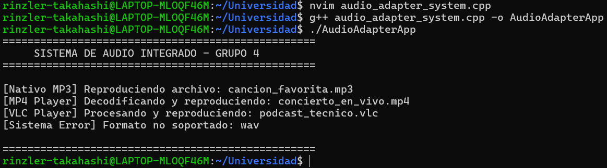

# Informe Técnico: Implementación del Patrón de Diseño Adapter en C++

**Asignatura:** Tecnología de Objetos  
**Grupo:** Grupo 4  
**Patrón Asignado:** Structural Pattern – Adapter (Adaptador)  
**Tema:** Patrones de Diseño de Software   
**Archivo Principal:** `audio_adapter_system.cpp`  
**Integrantes:**
* **Caracela Challco**, Anthony Jeffry
* **Cornejo Hurtado**, Dario Rafael
* **Fernández Lastarria**, Valerio Piero
* **Llavilla Machaca**, Frayd Yandel
* **Mamani Solórzano**, Efraín Alex
---

## 📋 Descripción del Proyecto

En el desarrollo de software orientado a objetos, es común integrar librerías de terceros o componentes legados (*legacy*) cuyas interfaces difieren de las requeridas por el cliente. 

En esta actividad, el **Grupo 4** implementa un **Sistema de Audio Heterogéneo**. El cliente del sistema espera reproducir archivos utilizando un método unificado `reproducir(tipo, archivo)`. Sin embargo, el módulo de reproducción avanzada (`ReproductorAvanzado`) utiliza métodos incompatibles (`reproducirVlc` y `reproducirMp4`).

Mediante el **Patrón de Diseño Adapter**, logramos acoplar ambas interfaces sin modificar el código preexistente ni vulnerar la arquitectura del cliente.

---

## 📐 Arquitectura del Patrón Adapter

```text
  +-----------------------+
  |   ReproductorAudio    |  <-- (Interfaz Target / Cliente)
  +-----------------------+
              ^
              | (Hereda)
  +-----------------------+        +------------------------+
  |    AdaptadorAudio     | -----> |  ReproductorAvanzado   |
  +-----------------------+ (Composición) +------------------------+
  | + reproducir()        |        | + reproducirVlc()      |
  +-----------------------+        | + reproducirMp4()      |
                                   +------------------------+
                                         (Adaptee)
```

### Componentes de la Solución:
1. **Target (Interfaz Objetivo):** `ReproductorAudio` — Define la interfaz abstracta estándar que interactúa con el cliente.
2. **Adaptee (Componente Adaptado):** `ReproductorAvanzado` — Clase con funcionalidad requerida pero interfaz incompatible.
3. **Adapter (Adaptador):** `AdaptadorAudio` — Implementa la interfaz `Target` y delega la ejecución al objeto `Adaptee`.
4. **Client (Cliente):** `ReproductorMusica` — Módulo principal que consume la interfaz `Target`.

---

## 💻 Código Fuente (`audio_adapter_system.cpp`)

```cpp
#include <iostream>
#include <string>
#include <memory>


// 1. Interfaz Target (Objetivo)

class ReproductorAudio {
public:
    virtual ~ReproductorAudio() = default;
    virtual void reproducir(const std::string& tipoArchivo, const std::string& nombreArchivo) = 0;
};


// 2. Adaptee (Sistema de Audio Incompatible)

class ReproductorAvanzado {
public:
    void reproducirVlc(const std::string& nombreArchivo) {
        std::cout << "[VLC Player] Procesando y reproduciendo: " << nombreArchivo << std::endl;
    }

    void reproducirMp4(const std::string& nombreArchivo) {
        std::cout << "[MP4 Player] Decodificando y reproduciendo: " << nombreArchivo << std::endl;
    }
};


// 3. Adapter (Adaptador de Interfaces)

class AdaptadorAudio : public ReproductorAudio {
private:
    // Encapsulamiento del componente adaptado mediante un puntero inteligente
    std::unique_ptr<ReproductorAvanzado> reproductorAvanzado;

public:
    AdaptadorAudio() : reproductorAvanzado(std::make_unique<ReproductorAvanzado>()) {}

    void reproducir(const std::string& tipoArchivo, const std::string& nombreArchivo) override {
        if (tipoArchivo == "vlc") {
            reproductorAvanzado->reproducirVlc(nombreArchivo);
        } else if (tipoArchivo == "mp4") {
            reproductorAvanzado->reproducirMp4(nombreArchivo);
        } else {
            std::cout << "[Adaptador Error] El formato '" << tipoArchivo 
                      << "' no es soportado por el adaptador." << std::endl;
        }
    }
};


// 4. Cliente / Sistema Principal

class ReproductorMusica : public ReproductorAudio {
private:
    std::unique_ptr<AdaptadorAudio> adaptador;

public:
    void reproducir(const std::string& tipoArchivo, const std::string& nombreArchivo) override {
        // Reproducción nativa para MP3
        if (tipoArchivo == "mp3") {
            std::cout << "[Nativo MP3] Reproduciendo archivo: " << nombreArchivo << std::endl;
        } 
        // Delegación al adaptador para formatos externos
        else if (tipoArchivo == "vlc" || tipoArchivo == "mp4") {
            adaptador = std::make_unique<AdaptadorAudio>();
            adaptador->reproducir(tipoArchivo, nombreArchivo);
        } else {
            std::cout << "[Sistema Error] Formato no soportado: " << tipoArchivo << std::endl;
        }
    }
};


// Punto de Entrada Principal (Main)

int main() {
    std::cout << "==================================================" << std::endl;
    std::cout << "     SISTEMA DE AUDIO INTEGRADO - GRUPO 4         " << std::endl;
    std::cout << "==================================================" << std::endl << std::endl;

    ReproductorMusica reproductor;

    // Pruebas de ejecución
    reproductor.reproducir("mp3", "cancion_favorita.mp3");
    reproductor.reproducir("mp4", "concierto_en_vivo.mp4");
    reproductor.reproducir("vlc", "podcast_tecnico.vlc");
    reproductor.reproducir("wav", "efecto_sonido.wav");

    std::cout << std::endl << "==================================================" << std::endl;
    return 0;
}
```

---

## 🛠️ Conceptos POO y Principios SOLID Aplicados

* **Encapsulamiento:** Las referencias internas al adaptador y a la clase adaptada están protegidas bajo modificadores `private`.
* **Herencia y Polimorfismo:** Uso de clases abstractas base (`ReproductorAudio`) y métodos virtuales puros para permitir la sustitución polimórfica en tiempo de ejecución.
* **Principio de Responsabilidad Única (SRP):** Cada clase cumple un propósito único (adaptación, decodificación o control nativo).
* **Principio Abierto/Cerrado (OCP):** Es posible agregar adaptadores para nuevos formatos sin modificar el código existente en `ReproductorMusica`.

---

## 🚀 Guía de Compilación y Ejecución en Terminal (Ubuntu/Linux)

Sigue estos comandos paso a paso para compilar y ejecutar la aplicación:

```bash
# 1. Actualizar el gestor de paquetes e instalar el compilador (si no está instalado)
sudo apt update && sudo apt install -y build-essential

# 2. Crear el archivo fuente de C++
nvim audio_adapter_system.cpp

# 3. Compilar el programa usando el estándar C++14 o superior
g++ -std=c++14 audio_adapter_system.cpp -o AudioAdapterApp

# 4. Ejecutar la aplicación
./AudioAdapterApp
```

---

## 🖥️ Salida en Consola


---

## 📝 Conclusiones

La implementación del patrón **Adapter** resuelve eficazmente la incompatibilidad entre interfaces sin comprometer el diseño de la arquitectura. Garantiza un código extensible, fácil de mantener y alineado a las buenas prácticas de la programación orientada a objetos.
