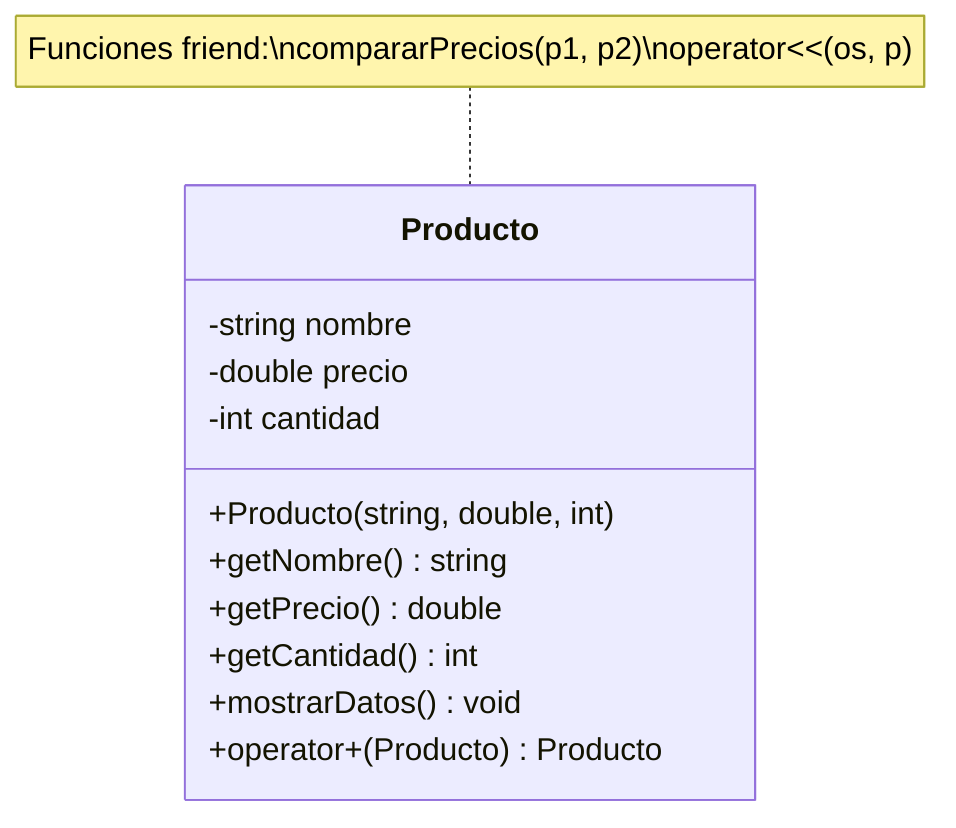
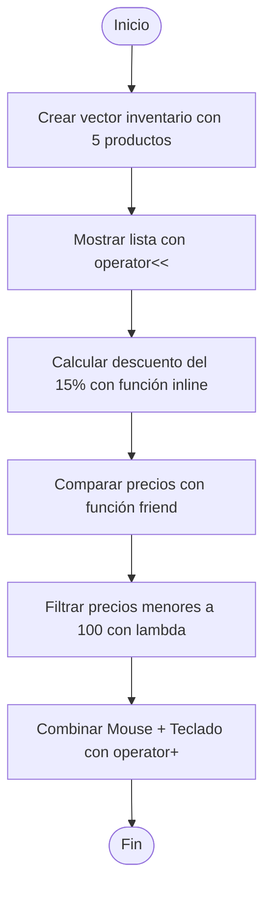
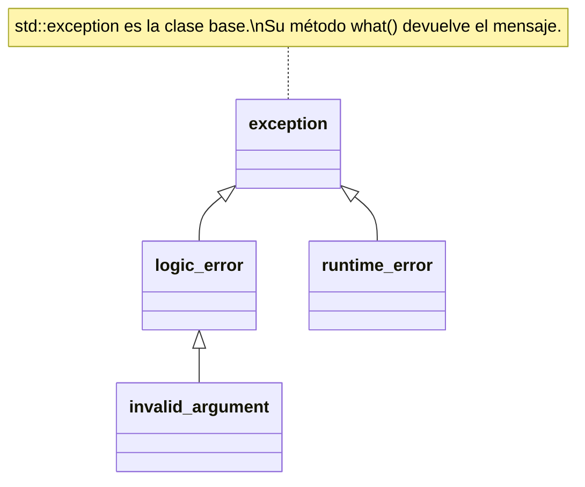
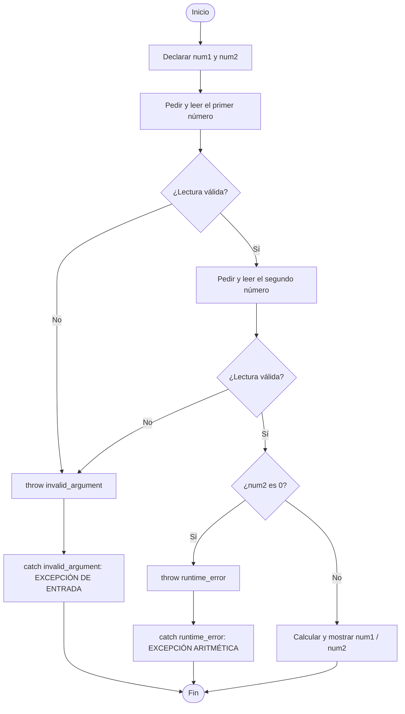
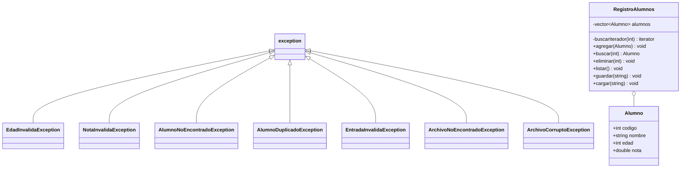
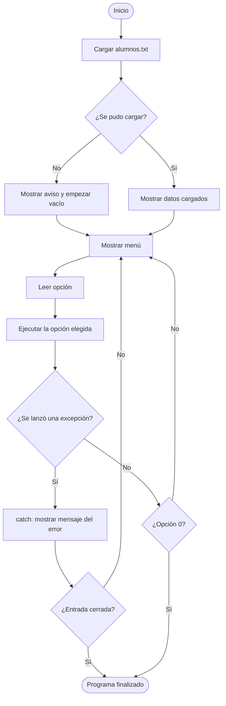

# Tecnología de Objetos


---

## Índice

1. [Información del proyecto](#información-del-proyecto)
2. [Estructura del repositorio](#estructura-del-repositorio)
3. [Práctica de Funciones en C++](#práctica-de-funciones-en-c)
   - [Ejercicio 1: Práctica 4 (Funciones Lambda)](#ejercicio-1-práctica-4-funciones-lambda)
   - [Ejercicio 2: Sistema de Productos (todos los grupos)](#ejercicio-2-sistema-de-productos-todos-los-grupos)
4. [Práctica de Manejo de Errores y Excepciones](#práctica-de-manejo-de-errores-y-excepciones)
   - [Ejercicio 1: Práctica 4 (Múltiples excepciones)](#ejercicio-1-práctica-4-múltiples-excepciones)
   - [Ejercicio 2: Sistema de Registro de Alumnos (todos los grupos)](#ejercicio-2-sistema-de-registro-de-alumnos-todos-los-grupos)
5. [Referencias](#referencias)

---

## Información del proyecto

Repositorio con las prácticas del curso **Tecnología de Objetos**, desarrolladas en C++. Cada práctica se documenta en este README con el enunciado, el código completo, la explicación paso a paso, la salida del programa y la conclusión.

| Dato | Detalle |
|---|---|
| Asignatura | Tecnología de Objetos |
| Universidad | Universidad Nacional de San Agustín de Arequipa (UNSA) |
| Docente | Mg. Maribel Molina Barriga |
| Elaborado por | Caracela Challco Anthony Jeffry |
| | Cornejo Hurtado Dario Rafael |
| | Llavilla Machaca Frayd Yandel |
| | Mamani Solorzano Efrain Alex |
| Lugar y fecha | Arequipa, Perú — 2026-B |
| Lenguaje | C++ (estándar C++11 o superior) |
| Compilador | `g++` |

### Contenido del repositorio

| Práctica | Temas | Ejercicios |
|---|---|---|
| Práctica de Funciones en C++ | Funciones `inline`, `friend`, constantes (`const`), lambda y sobrecarga de operadores | Práctica 4 (Funciones Lambda) y Sistema de Productos |
| Práctica de Manejo de Errores y Excepciones | `try`, `throw` y `catch`, excepciones estándar y personalizadas, validación de entrada y manejo de archivos | Práctica 4 (Múltiples excepciones) y Sistema de Registro de Alumnos |

Cada ejercicio incluye su propio comando de compilación en su sección. Los requisitos generales para compilarlos están más abajo, en "Requisitos generales".

---

## Estructura del repositorio

```
TO-A/
├── README.md
├── Práctica de Funciones en C++/
│   ├── Prac04_Lambda.cpp
│   └── Sistema_Productos.cpp
└── Práctica de Manejo de Errores y Excepciones/
    ├── Prac04_Errores.cpp
    └── registro_alumnos.cpp
    
```

### Requisitos generales

| Requisito | Versión |
|---|---|
| Compilador | `g++` |
| Estándar | C++11 o superior |
| Sistema | Linux / WSL / Windows con MinGW |

---

## Práctica de Funciones en C++

Funciones **inline**, **friend**, **constantes (const)**, **lambda** y **sobrecarga de operadores**. Esta práctica tiene dos ejercicios:

| Ejercicio | Archivo | Conceptos que usa |
|---|---|---|
| Práctica 4: Funciones Lambda | `Prac04_Lambda.cpp` | Lambda (capturas, `count_if`, `for_each`, `sort`) |
| Sistema de Productos (todos los grupos) | `Sistema_Productos.cpp` | Inline, friend, const, lambda, `operator+` y `operator<<` |

---

### Ejercicio 1: Práctica 4 (Funciones Lambda)

Archivo: `Práctica de Funciones en C++/Prac04_Lambda.cpp`

#### 1. ¿Qué se pedía?

Usar funciones lambda para procesar datos de un vector de forma rápida. El enunciado pedía:

1. Crear un `vector<int>` con al menos 10 números.
2. Usar una lambda para contar los números pares.
3. Usar una lambda para calcular la suma total.
4. Usar una lambda para mostrar los números mayores que un valor dado.
5. Reto adicional: ordenar el vector con `std::sort` y una lambda personalizada.

##### Requisitos del enunciado y cómo se cumplen

| Requisito | ¿Cumplido? | Dónde se cumple |
|---|---|---|
| Vector con al menos 10 números | Sí | `numeros` tiene 10 elementos |
| Contar los números pares | Sí | Lambda 2 (`esPar`) con `std::count_if` |
| Calcular la suma total | Sí | Lambda 3 (`sumar`) con `std::for_each` |
| Mostrar los mayores que un valor dado | Sí | Lambda 4 (`mostrarMayores`), con `limite = 10` |
| Reto: ordenar con `std::sort` y lambda | Sí | Lambda 5 (`comparadorDescendente`) |
| Mostrar el vector (apoyo) | Sí | Lambda 1 (`mostrarVector`) |

#### 2. ¿Qué es una lambda?

Una lambda es una función **sin nombre** que se escribe en el mismo lugar donde se va a usar. Sirve para cosas cortas y rápidas, como filtrar, recorrer o ordenar datos.

Su forma general es:

```
[captura](parámetros) { cuerpo }
```

- **`[captura]`**: las variables de afuera que la lambda puede usar.
  - `[]` no usa nada de afuera.
  - `[limite]` usa una **copia** de la variable (captura por valor).
  - `[&sumaTotal]` usa la **variable original** y puede cambiarla (captura por referencia).
- **`(parámetros)`**: los datos que recibe, igual que una función normal.
- **`{ cuerpo }`**: lo que hace la lambda.

##### Tipos de captura (comparación)

| Tipo | Sintaxis | La lambda usa... | ¿Puede cambiar la variable original? | Ejemplo en esta práctica |
|---|---|---|---|---|
| Sin captura | `[]` | Solo lo que recibe por parámetro | No aplica | `mostrarVector`, `esPar`, `comparadorDescendente` |
| Por valor | `[limite]` | Una **copia** de la variable | No | `mostrarMayores` |
| Por referencia | `[&sumaTotal]` | La variable **original** | Sí | `sumar` |

#### 3. Código completo

```cpp
#include <iostream>
#include <vector>
#include <algorithm>

int main() {
    std::vector<int> numeros = {12, 5, 8, 19, 24, 3, 17, 30, 1, 10};

    // Lambda 1: Imprime los elementos de un vector recibido por referencia constante
    auto mostrarVector = [](const std::vector<int>& vec) {
        for (int n : vec) {
            std::cout << n << " ";
        }
        std::cout << "\n";
    };

    std::cout << "Resultado Lambda 1 - Vector inicial:\n";
    mostrarVector(numeros);

    // Lambda 2: Comprueba si un numero es par retornando un valor booleano
    auto esPar = [](int n) {
        return n % 2 == 0;
    };
    int cantidadPares = std::count_if(numeros.begin(), numeros.end(), esPar);
    std::cout << "\nResultado Lambda 2 - Cantidad de numeros pares:\n" << cantidadPares << "\n";

    // Lambda 3: Captura la variable sumaTotal por referencia y acumula el valor de cada elemento
    int sumaTotal = 0;
    auto sumar = [&sumaTotal](int n) {
        sumaTotal += n;
    };
    std::for_each(numeros.begin(), numeros.end(), sumar);
    std::cout << "\nResultado Lambda 3 - Suma total de elementos:\n" << sumaTotal << "\n";

    // Lambda 4: Captura por valor la variable limite e imprime los elementos que la superan
    int limite = 10;
    std::cout << "\nResultado Lambda 4 - Elementos mayores al limite indicado:\n";
    auto mostrarMayores = [limite](int n) {
        if (n > limite) {
            std::cout << n << " ";
        }
    };
    std::for_each(numeros.begin(), numeros.end(), mostrarMayores);
    std::cout << "\n";

    // Lambda 5: Compara dos elementos y retorna verdadero si el primero es mayor para ordenar de forma descendente
    auto comparadorDescendente = [](int a, int b) {
        return a > b;
    };
    std::sort(numeros.begin(), numeros.end(), comparadorDescendente);

    std::cout << "\nResultado Lambda 5 - Vector ordenado de mayor a menor:\n";
    mostrarVector(numeros);

    return 0;
}
```

#### 4. Explicación paso a paso

##### Diagrama de flujo del programa


##### Librerías usadas

| Librería | Para qué se usa |
|---|---|
| `<iostream>` | Mostrar datos en pantalla con `std::cout`. |
| `<vector>` | Poder usar `std::vector`, una lista de datos que puede cambiar de tamaño. |
| `<algorithm>` | Usar `std::count_if`, `std::for_each` y `std::sort`, que reciben lambdas. |

Funciones de `<algorithm>` que reciben lambdas en este programa:

| Función | Qué hace | Lambda que recibe |
|---|---|---|
| `std::count_if` | Cuenta cuántos elementos cumplen una condición | `esPar` |
| `std::for_each` | Aplica una acción a cada elemento del vector | `sumar` y `mostrarMayores` |
| `std::sort` | Ordena el vector según el criterio que se le da | `comparadorDescendente` |

##### El vector

```cpp
std::vector<int> numeros = {12, 5, 8, 19, 24, 3, 17, 30, 1, 10};
```

Se crea un vector con **10 números enteros**, que es el mínimo que pedía el enunciado. Todas las lambdas trabajan con estos datos.

##### Lambda 1: `mostrarVector` (mostrar el vector)

```cpp
auto mostrarVector = [](const std::vector<int>& vec) {
    for (int n : vec) {
        std::cout << n << " ";
    }
    std::cout << "\n";
};
```

- **Qué hace:** recorre el vector y muestra cada número separado por un espacio.
- **Captura `[]`:** vacía, porque no necesita variables de afuera. Todo lo que usa lo recibe por parámetro.
- **Parámetro `const std::vector<int>& vec`:** recibe el vector **por referencia** (`&`), así no se hace una copia, y es **constante** (`const`), así la lambda no puede modificarlo.
- **Por qué se usa dos veces:** se escribe una sola vez y se reutiliza para mostrar el vector al inicio y al final (ya ordenado).

##### Lambda 2: `esPar` (contar los pares)

```cpp
auto esPar = [](int n) {
    return n % 2 == 0;
};
int cantidadPares = std::count_if(numeros.begin(), numeros.end(), esPar);
```

- **Qué hace:** revisa si un número es par. Un número es par si al dividirlo entre 2 el residuo (`%`) es 0.
- **Retorna:** `true` si es par, `false` si no lo es.
- **`std::count_if`:** recorre todo el vector y **cuenta** cuántas veces la lambda devolvió `true`.
- **Pares encontrados:** 12, 8, 24, 30 y 10, por lo tanto el resultado es **5**.

Seguimiento de la lambda, número por número:

| Número | `n % 2` | ¿Es par? |
|---|---|---|
| 12 | 0 | Sí |
| 5 | 1 | No |
| 8 | 0 | Sí |
| 19 | 1 | No |
| 24 | 0 | Sí |
| 3 | 1 | No |
| 17 | 1 | No |
| 30 | 0 | Sí |
| 1 | 1 | No |
| 10 | 0 | Sí |
| **Total de pares** | | **5** |

##### Lambda 3: `sumar` (suma total)

```cpp
int sumaTotal = 0;
auto sumar = [&sumaTotal](int n) {
    sumaTotal += n;
};
std::for_each(numeros.begin(), numeros.end(), sumar);
```

- **Qué hace:** va sumando cada número del vector en la variable `sumaTotal`.
- **Captura `[&sumaTotal]`:** el `&` significa captura **por referencia**. La lambda trabaja con la variable original, no con una copia, por eso puede ir acumulando la suma y el valor final se ve afuera.
- **`std::for_each`:** recorre todo el vector y le pasa cada número a la lambda.
- **Resultado:** 12 + 5 + 8 + 19 + 24 + 3 + 17 + 30 + 1 + 10 = **129**.

Cómo va cambiando `sumaTotal` en cada paso:

| Paso | Número `n` | `sumaTotal` antes | `sumaTotal` después |
|---|---|---|---|
| 1 | 12 | 0 | 12 |
| 2 | 5 | 12 | 17 |
| 3 | 8 | 17 | 25 |
| 4 | 19 | 25 | 44 |
| 5 | 24 | 44 | 68 |
| 6 | 3 | 68 | 71 |
| 7 | 17 | 71 | 88 |
| 8 | 30 | 88 | 118 |
| 9 | 1 | 118 | 119 |
| 10 | 10 | 119 | **129** |

##### Lambda 4: `mostrarMayores` (mayores que un valor)

```cpp
int limite = 10;
auto mostrarMayores = [limite](int n) {
    if (n > limite) {
        std::cout << n << " ";
    }
};
std::for_each(numeros.begin(), numeros.end(), mostrarMayores);
```

- **Qué hace:** muestra solo los números que son mayores que `limite`.
- **Captura `[limite]`:** sin `&`, es captura **por valor**. La lambda guarda una **copia** de `limite` (que vale 10). Solo necesita leer ese valor, no cambiarlo.
- **Resultado:** los mayores que 10 son **12, 19, 24, 17 y 30**. El 10 no aparece porque no es mayor, es igual.

Seguimiento con `limite = 10`:

| Número `n` | ¿`n > 10`? | ¿Se muestra? |
|---|---|---|
| 12 | Sí | Sí |
| 5 | No | No |
| 8 | No | No |
| 19 | Sí | Sí |
| 24 | Sí | Sí |
| 3 | No | No |
| 17 | Sí | Sí |
| 30 | Sí | Sí |
| 1 | No | No |
| 10 | No (es igual, no mayor) | No |

##### Lambda 5: `comparadorDescendente` (ordenar, reto adicional)

```cpp
auto comparadorDescendente = [](int a, int b) {
    return a > b;
};
std::sort(numeros.begin(), numeros.end(), comparadorDescendente);
```

- **Qué hace:** le dice a `std::sort` cómo comparar dos números. Devuelve `true` si `a` es mayor que `b`, así el mayor va primero.
- **Por qué es necesaria:** por defecto `std::sort` ordena de menor a mayor. Con esta lambda personalizada se ordena de **mayor a menor**.
- **Resultado:** `30 24 19 17 12 10 8 5 3 1`.

Vector antes y después de ordenar:

| Posición | Antes | Después |
|---|---|---|
| 1 | 12 | 30 |
| 2 | 5 | 24 |
| 3 | 8 | 19 |
| 4 | 19 | 17 |
| 5 | 24 | 12 |
| 6 | 3 | 10 |
| 7 | 17 | 8 |
| 8 | 30 | 5 |
| 9 | 1 | 3 |
| 10 | 10 | 1 |

#### 5. Salida del programa

```
Resultado Lambda 1 - Vector inicial:
12 5 8 19 24 3 17 30 1 10 

Resultado Lambda 2 - Cantidad de numeros pares:
5

Resultado Lambda 3 - Suma total de elementos:
129

Resultado Lambda 4 - Elementos mayores al limite indicado:
12 19 24 17 30 

Resultado Lambda 5 - Vector ordenado de mayor a menor:
30 24 19 17 12 10 8 5 3 1 
```

#### 6. Resumen de las lambdas

| Lambda | Captura | Qué hace | Se usa con | Resultado |
|---|---|---|---|---|
| `mostrarVector` | `[]` | Imprime el vector | Llamada directa | Muestra los 10 números |
| `esPar` | `[]` | Dice si un número es par | `std::count_if` | 5 pares |
| `sumar` | `[&sumaTotal]` (referencia) | Acumula la suma | `std::for_each` | 129 |
| `mostrarMayores` | `[limite]` (valor) | Muestra los mayores al límite | `std::for_each` | 12 19 24 17 30 |
| `comparadorDescendente` | `[]` | Compara para ordenar de mayor a menor | `std::sort` | 30 24 19 17 12 10 8 5 3 1 |

#### 7. Cómo compilar y ejecutar

```
g++ Prac04_Lambda.cpp -o Prac04_Lambda
./Prac04_Lambda
```

#### 8. Conclusión

Las lambdas permiten escribir funciones cortas justo donde se necesitan, sin tener que declarar una función aparte. En esta práctica se vio cómo usarlas para mostrar, contar, sumar, filtrar y ordenar datos de un vector, y cómo la **captura** (por valor o por referencia) controla qué variables de afuera puede usar cada lambda.

---

### Ejercicio 2: Sistema de Productos (todos los grupos)

Archivo: `Práctica de Funciones en C++/Sistema_Productos.cpp`

#### 1. ¿Qué se pedía?

Diseñar un programa llamado **"Sistema de Productos"** que integre todas las funciones del tema en un mini sistema. El enunciado pedía:

1. Usar una función **inline** para calcular el descuento de un producto.
2. Tener una clase `Producto` con atributos privados y una función **friend** que compare precios.
3. Usar funciones **const** para mostrar datos sin modificarlos.
4. Aplicar una **lambda** para filtrar productos por precio.
5. Sobrecargar el operador **+** para combinar productos (sumar precios o cantidades).
6. Reto adicional: sobrecargar el operador **<<** para mostrar el producto en formato legible.

##### Requisitos del enunciado y cómo se cumplen

| Requisito | ¿Cumplido? | Dónde se cumple |
|---|---|---|
| Función inline para el descuento | Sí | `calcularDescuento(precio, porcentaje)` |
| Clase `Producto` con atributos privados | Sí | `nombre`, `precio` y `cantidad` son `private` |
| Función friend que compare precios | Sí | `compararPrecios(p1, p2)` |
| Funciones const para mostrar datos | Sí | `getNombre()`, `getPrecio()`, `getCantidad()` y `mostrarDatos()` |
| Lambda para filtrar por precio | Sí | `filtrarPorPrecio` con `limitePrecio = 100` |
| Sobrecarga del operador + | Sí | `Producto operator+(const Producto&) const` |
| Reto: sobrecarga del operador << | Sí | `friend std::ostream& operator<<(...)` |

#### 2. Conceptos aplicados

| Concepto | Palabra clave | Dónde se usa en el programa | Propósito |
|---|---|---|---|
| Función inline | `inline` | `calcularDescuento` | Calcular el descuento sin el costo de una llamada |
| Función friend | `friend` | `compararPrecios` | Leer atributos privados para comparar precios |
| Funciones constantes | `const` | `getNombre()`, `getPrecio()`, `getCantidad()`, `mostrarDatos()` | Consultar datos sin modificar el objeto |
| Función lambda | `[ ]( ) { }` | `filtrarPorPrecio` | Filtrar productos con precio menor a un límite |
| Sobrecarga de `+` | `operator+` | `inventario[1] + inventario[2]` | Combinar dos productos (suma precios y cantidades) |
| Sobrecarga de `<<` | `operator<<` | `std::cout << producto` | Mostrar el producto en formato de tabla |

#### 3. Diseño del programa

##### Diagrama de clase



##### Diagrama de flujo del programa



##### Inventario de prueba

| Producto | Precio ($) | Cantidad |
|---|---:|---:|
| Laptop | 1200.00 | 5 |
| Mouse | 25.00 | 20 |
| Teclado | 45.00 | 15 |
| Monitor | 300.00 | 8 |
| Audifonos | 80.00 | 12 |

#### 4. Código completo

```cpp
#include <iostream>
#include <string>
#include <vector>
#include <algorithm>
#include <iomanip> // Libreria para alineacion simetrica de columnas

// 1. FUNCION INLINE: Calcula el precio aplicando un porcentaje de descuento
inline double calcularDescuento(double precio, double porcentaje) {
    return precio * (1.0 - porcentaje / 100.0);
}

class Producto {
private:
    std::string nombre;
    double precio;
    int cantidad;

public:
    // Constructor de la clase
    Producto(std::string n = "Sin nombre", double p = 0.0, int c = 0)
        : nombre(n), precio(p), cantidad(c) {}

    // 3. FUNCIONES CONSTANTES: Permiten consultar atributos sin modificar el objeto
    std::string getNombre() const {
        return nombre;
    }

    double getPrecio() const {
        return precio;
    }

    int getCantidad() const {
        return cantidad;
    }

    void mostrarDatos() const {
        std::cout << std::left << std::setw(18) << nombre
                  << " | $" << std::right << std::setw(8) << std::fixed << std::setprecision(2) << precio
                  << " | " << std::right << std::setw(8) << cantidad << "\n";
    }

    // 5. SOBRECARGA DEL OPERADOR +: Combina dos productos sumando precios y cantidades
    Producto operator+(const Producto& otro) const {
        std::string nombreCombinado = nombre + " + " + otro.nombre;
        double precioSumado = precio + otro.precio;
        int cantidadTotal = cantidad + otro.cantidad;
        return Producto(nombreCombinado, precioSumado, cantidadTotal);
    }

    // 2. FUNCION FRIEND: Accede a atributos privados para comparar precios
    friend void compararPrecios(const Producto& p1, const Producto& p2);

    // RETO ADICIONAL: Sobrecarga del operador << para imprimir en formato de tabla alineada
    friend std::ostream& operator<<(std::ostream& os, const Producto& p) {
        os << std::left << std::setw(18) << p.nombre
           << " | $" << std::right << std::setw(8) << std::fixed << std::setprecision(2) << p.precio
           << " | " << std::right << std::setw(8) << p.cantidad;
        return os;
    }
};

// Implementacion de la funcion amiga
void compararPrecios(const Producto& p1, const Producto& p2) {
    std::cout << std::left << std::setw(12) << p1.nombre << " vs " << std::setw(12) << p2.nombre << " -> ";
    if (p1.precio > p2.precio) {
        std::cout << p1.nombre << " es mas caro\n";
    } else if (p2.precio > p1.precio) {
        std::cout << p2.nombre << " es mas caro\n";
    } else {
        std::cout << "Ambos tienen el mismo precio\n";
    }
}

// Funcion auxiliar para imprimir el encabezado de las tablas
void imprimirEncabezadoTabla() {
    std::cout << std::left << std::setw(18) << "PRODUCTO"
              << " | " << std::right << std::setw(9) << "PRECIO"
              << " | " << std::right << std::setw(8) << "CANTIDAD" << "\n";
    std::cout << std::string(42, '-') << "\n";
}

int main() {
    std::vector<Producto> inventario = {
        Producto("Laptop", 1200.0, 5),
        Producto("Mouse", 25.0, 20),
        Producto("Teclado", 45.0, 15),
        Producto("Monitor", 300.0, 8),
        Producto("Audifonos", 80.0, 12)
    };

    std::cout << "==========================================" << "\n";
    std::cout << "          SISTEMA DE PRODUCTOS            " << "\n";
    std::cout << "==========================================" << "\n\n";

    // Demostracion del RETO ADICIONAL y FUNCION CONST: Impresion simetrica con operador <<
    std::cout << "--- LISTA DE PRODUCTOS EN INVENTARIO ---\n";
    imprimirEncabezadoTabla();
    for (const auto& prod : inventario) {
        std::cout << prod << "\n";
    }
    std::cout << std::string(42, '-') << "\n\n";

    // Demostracion de FUNCION INLINE
    std::cout << "--- CALCULO DE DESCUENTO (Funcion Inline) ---\n";
    double precioOriginal = inventario[0].getPrecio();
    double porcentajeDescuento = 15.0;
    double precioFinal = calcularDescuento(precioOriginal, porcentajeDescuento);

    std::cout << std::left << std::setw(22) << "Producto:" << inventario[0].getNombre() << "\n";
    std::cout << std::left << std::setw(22) << "Precio Original:" << "$" << std::fixed << std::setprecision(2) << precioOriginal << "\n";
    std::cout << std::left << std::setw(22) << "Descuento:" << porcentajeDescuento << "%\n";
    std::cout << std::left << std::setw(22) << "Precio Con Descuento:" << "$" << precioFinal << "\n\n";

    // Demostracion de FUNCION FRIEND
    std::cout << "--- COMPARACION DE PRECIOS (Funcion Friend) ---\n";
    compararPrecios(inventario[0], inventario[3]);
    compararPrecios(inventario[1], inventario[4]);
    std::cout << "\n";

    // Demostracion de LAMBDA: Filtrar productos por precio menor a un limite
    double limitePrecio = 100.0;
    std::cout << "--- FILTRADO CON LAMBDA (Productos menores a $" << limitePrecio << ") ---\n";
    imprimirEncabezadoTabla();
    auto filtrarPorPrecio = [limitePrecio](const Producto& p) {
        if (p.getPrecio() < limitePrecio) {
            std::cout << p << "\n";
        }
    };
    std::for_each(inventario.begin(), inventario.end(), filtrarPorPrecio);
    std::cout << std::string(42, '-') << "\n\n";

    // Demostracion de SOBRECARGA DEL OPERADOR +
    std::cout << "--- COMBINACION DE PRODUCTOS (Operador +) ---\n";
    Producto combo = inventario[1] + inventario[2]; // Combinar Mouse + Teclado
    imprimirEncabezadoTabla();
    std::cout << combo << "\n";
    std::cout << std::string(42, '-') << "\n";

    return 0;
}
```

#### 5. Explicación paso a paso

##### Librerías usadas

| Librería | Para qué se usa |
|---|---|
| `<iostream>` | Mostrar datos en pantalla con `std::cout`. |
| `<string>` | Manejar el nombre del producto con `std::string`. |
| `<vector>` | Guardar el inventario en un `std::vector<Producto>`. |
| `<algorithm>` | Usar `std::for_each`, que recibe la lambda de filtrado. |
| `<iomanip>` | Alinear columnas y fijar decimales (`setw`, `left`, `right`, `fixed`, `setprecision`). |

##### Función inline: `calcularDescuento`

```cpp
inline double calcularDescuento(double precio, double porcentaje) {
    return precio * (1.0 - porcentaje / 100.0);
}
```

- **Qué hace:** devuelve el precio final después de restar el porcentaje de descuento.
- **Por qué `inline`:** es un cálculo muy corto, así que el compilador puede reemplazar la llamada por el cuerpo de la función y evitar el salto de llamada.
- **En el programa:** se aplica un 15 % a la Laptop, de $1200.00 a **$1020.00**.

| Dato | Valor |
|---|---|
| Precio original | 1200.00 |
| Descuento | 15 % |
| Fórmula | 1200 × (1 − 15/100) = 1200 × 0.85 |
| Precio final | **1020.00** |

##### Clase `Producto` (atributos privados)

- Tiene tres atributos **privados**: `nombre` (`std::string`), `precio` (`double`) y `cantidad` (`int`).
- Desde `main` no se puede escribir `producto.precio`: solo se llega a los datos con los métodos de la clase o con funciones amigas.
- El constructor tiene valores por defecto, así que también se puede crear un producto vacío (`"Sin nombre"`, 0.0, 0).

##### Función friend: `compararPrecios`

```cpp
friend void compararPrecios(const Producto& p1, const Producto& p2);
```

- **Qué hace:** compara los precios de dos productos e imprime cuál es más caro.
- **Por qué es friend:** se declara dentro de la clase con `friend`, pero se implementa fuera como función normal. Así puede leer `p1.precio` y `p2.precio` directamente, sin usar los getters.
- **Parámetros:** `const Producto&`, para no copiar los objetos ni modificarlos.

| Comparación | Precios | Resultado |
|---|---|---|
| Laptop vs Monitor | 1200.00 vs 300.00 | Laptop es más caro |
| Mouse vs Audifonos | 25.00 vs 80.00 | Audifonos es más caro |

##### Funciones constantes (`const`)

| Método | Qué hace | ¿Modifica el objeto? |
|---|---|---|
| `getNombre() const` | Devuelve el nombre | No |
| `getPrecio() const` | Devuelve el precio | No |
| `getCantidad() const` | Devuelve la cantidad | No |
| `mostrarDatos() const` | Imprime una fila con los datos del producto | No |

- El `const` al final garantiza que la función no cambia los atributos. Si se intentara, el compilador mostraría un error.
- Gracias a eso se pueden usar con objetos constantes, como el parámetro `const Producto& p` de la lambda o el recorrido `for (const auto& prod : inventario)`.
- **Nota:** `mostrarDatos()` queda definida en la clase, pero la impresión de las tablas se hace con el operador `<<`, por lo que no se llama en `main`.

##### Función lambda: `filtrarPorPrecio`

```cpp
double limitePrecio = 100.0;
auto filtrarPorPrecio = [limitePrecio](const Producto& p) {
    if (p.getPrecio() < limitePrecio) {
        std::cout << p << "\n";
    }
};
std::for_each(inventario.begin(), inventario.end(), filtrarPorPrecio);
```

- **Qué hace:** muestra solo los productos con precio menor al límite.
- **Captura `[limitePrecio]`:** por **valor**. La lambda guarda una copia del límite (100.0) y solo lo lee.
- **Se usa con:** `std::for_each`, que le pasa cada producto del inventario.

| Producto | Precio | ¿Precio < 100? | ¿Se muestra? |
|---|---:|---|---|
| Laptop | 1200.00 | No | No |
| Mouse | 25.00 | Sí | Sí |
| Teclado | 45.00 | Sí | Sí |
| Monitor | 300.00 | No | No |
| Audifonos | 80.00 | Sí | Sí |

##### Sobrecarga del operador `+`

```cpp
Producto operator+(const Producto& otro) const {
    std::string nombreCombinado = nombre + " + " + otro.nombre;
    double precioSumado = precio + otro.precio;
    int cantidadTotal = cantidad + otro.cantidad;
    return Producto(nombreCombinado, precioSumado, cantidadTotal);
}
```

- **Qué hace:** crea un producto nuevo que une los nombres, suma los precios y suma las cantidades.
- **Es `const`:** no modifica ninguno de los dos productos originales.

| Atributo | Mouse | Teclado | Resultado (Mouse + Teclado) |
|---|---|---|---|
| Nombre | Mouse | Teclado | Mouse + Teclado |
| Precio | 25.00 | 45.00 | **70.00** |
| Cantidad | 20 | 15 | **35** |

##### Sobrecarga del operador `<<` (reto adicional)

```cpp
friend std::ostream& operator<<(std::ostream& os, const Producto& p) {
    os << std::left << std::setw(18) << p.nombre
       << " | $" << std::right << std::setw(8) << std::fixed << std::setprecision(2) << p.precio
       << " | " << std::right << std::setw(8) << p.cantidad;
    return os;
}
```

- **Qué hace:** permite escribir `std::cout << producto` y que salga una fila de tabla con formato.
- **Por qué es friend:** necesita leer los atributos privados del producto.
- **Por qué retorna `os`:** así se pueden encadenar salidas, por ejemplo `std::cout << prod << "\n"`.
- **Manipuladores de `<iomanip>`:**

| Manipulador | Para qué sirve |
|---|---|
| `setw(n)` | Fija el ancho del campo en `n` caracteres |
| `left` / `right` | Alinea a la izquierda o a la derecha |
| `fixed` | Muestra los decimales de forma fija |
| `setprecision(2)` | Muestra 2 decimales |

#### 6. Salida del programa

```
==========================================
          SISTEMA DE PRODUCTOS
==========================================

--- LISTA DE PRODUCTOS EN INVENTARIO ---
PRODUCTO           |    PRECIO | CANTIDAD
------------------------------------------
Laptop             | $ 1200.00 |        5
Mouse              | $   25.00 |       20
Teclado            | $   45.00 |       15
Monitor            | $  300.00 |        8
Audifonos          | $   80.00 |       12
------------------------------------------

--- CALCULO DE DESCUENTO (Funcion Inline) ---
Producto:             Laptop
Precio Original:      $1200.00
Descuento:            15.00%
Precio Con Descuento: $1020.00

--- COMPARACION DE PRECIOS (Funcion Friend) ---
Laptop       vs Monitor      -> Laptop es mas caro
Mouse        vs Audifonos    -> Audifonos es mas caro

--- FILTRADO CON LAMBDA (Productos menores a $100.00) ---
PRODUCTO           |    PRECIO | CANTIDAD
------------------------------------------
Mouse              | $   25.00 |       20
Teclado            | $   45.00 |       15
Audifonos          | $   80.00 |       12
------------------------------------------

--- COMBINACION DE PRODUCTOS (Operador +) ---
PRODUCTO           |    PRECIO | CANTIDAD
------------------------------------------
Mouse + Teclado    | $   70.00 |       35
------------------------------------------
```

#### 7. Resultados

| Operación | Entrada | Resultado |
|---|---|---|
| Descuento (inline) | Laptop $1200.00 con 15 % | **$1020.00** |
| Comparación (friend) | Laptop vs Monitor | Laptop es más caro |
| Comparación (friend) | Mouse vs Audifonos | Audifonos es más caro |
| Filtro (lambda) | Precio menor a $100 | Mouse, Teclado y Audifonos |
| Combinación (`operator+`) | Mouse + Teclado | **$70.00**, 35 unidades |

#### 8. Cómo compilar y ejecutar

```
g++ -std=c++11 Sistema_Productos.cpp -o sistema_productos
./sistema_productos
```

#### 9. Reto adicional

✅ **Sobrecarga del operador `<<`:** el producto se imprime directamente con `std::cout << producto`, en formato de tabla alineada. Se usa en la lista del inventario, en el filtrado con lambda y en el producto combinado.

#### 10. Conclusión

El Sistema de Productos integra en un solo programa todos los conceptos de la práctica. La función **inline** resuelve el descuento sin costo de llamada, la función **friend** compara precios accediendo a datos privados, las funciones **const** protegen el estado del objeto, la **lambda** filtra el inventario capturando el límite de precio, y la **sobrecarga de operadores** (`+` y `<<`) permite combinar y mostrar productos de forma natural.

---

## Práctica de Manejo de Errores y Excepciones

El **manejo de errores** permite detectar, controlar y responder a situaciones anómalas durante la ejecución, evitando que el programa se detenga de forma abrupta. En C++ se hace con las palabras clave `try`, `throw` y `catch` [1]. Esta práctica tiene dos ejercicios:

| Ejercicio | Archivo | Conceptos que usa |
|---|---|---|
| Práctica 4: Múltiples excepciones | `Prac04_Errores.cpp` | `try` con varios `catch`, `std::invalid_argument`, `std::runtime_error`, `std::exception` |
| Sistema de Registro de Alumnos (todos los grupos) | `registro_alumnos.cpp` | Excepciones personalizadas, validación de entrada, archivos no encontrados o corruptos |

---

### Ejercicio 1: Práctica 4 (Múltiples excepciones)

Archivo: `Práctica de Manejo de Errores y Excepciones/Prac04_Errores.cpp`

#### 1. ¿Qué se pedía?

**Objetivo:** manejar diferentes tipos de errores en un solo bloque. El enunciado pedía:

1. Pedir dos números y dividir.
2. Si el usuario no ingresa un número, capturar un error de tipo.
3. Si divide por cero, capturar un error aritmético.
4. Mostrar mensajes distintos para cada tipo de error.

##### Requisitos del enunciado y cómo se cumplen

| Requisito | ¿Cumplido? | Dónde se cumple |
|---|---|---|
| Pedir dos números y dividir | Sí | `std::cin >> num1`, `std::cin >> num2` y `num1 / num2` |
| Capturar el error de tipo | Sí | `throw std::invalid_argument` y `catch (const std::invalid_argument&)` |
| Capturar el error aritmético | Sí | `throw std::runtime_error` y `catch (const std::runtime_error&)` |
| Mensajes distintos por tipo de error | Sí | `[EXCEPCIÓN DE ENTRADA]`, `[EXCEPCIÓN ARITMÉTICA]` y `[EXCEPCIÓN GENÉRICA]` |
| Un solo bloque `try` para todo | Sí | Un único `try` con tres `catch` |

#### 2. Fundamento teórico

Una **excepción** es un evento que interrumpe el flujo normal del programa. Cuando se lanza con `throw`, la ejecución salta al primer `catch` cuyo tipo coincide con el de la excepción lanzada [1].

##### Palabras clave en C++ (comparación con otros lenguajes)

| Lenguaje | Captura | Lanzamiento | Bloque final |
|---|---|---|---|
| Java | `try-catch` | `throw` / `throws` | `finally` |
| Python | `try-except` | `raise` | `finally` |
| C# | `try-catch` | `throw` | `finally` |
| C++ | `try-catch` | `throw` | No existe (se usa RAII) |

##### Por qué hay que lanzar las excepciones a mano

En C++ los errores de este ejercicio **no lanzan excepciones por sí solos**:

| Situación | Qué pasa realmente en C++ | Cómo se resuelve |
|---|---|---|
| El usuario escribe letras en vez de un número | `std::cin` pone el estado de error (`failbit`) y la lectura devuelve falso, sin lanzar nada | Se comprueba `if (!(std::cin >> num1))` y se lanza `std::invalid_argument` |
| División entre cero con enteros | Comportamiento indefinido | Se comprueba `num2 == 0` antes de dividir |
| División entre cero con `double` | Da `inf`, no hay error | Se comprueba `num2 == 0` antes de dividir |

Por eso el programa valida primero y lanza la excepción adecuada con `throw`.

##### Equivalencia de los errores pedidos

| Error del enunciado | Excepción de C++ usada | Familia en la jerarquía |
|---|---|---|
| Error de tipo | `std::invalid_argument` | `std::logic_error` |
| Error aritmético | `std::runtime_error` | `std::runtime_error` |
| Cualquier otro | `std::exception` | Clase base de todas |



#### 3. Código completo

```cpp
#include <iostream>
#include <stdexcept>
#include <limits>

int main() {
    double num1, num2;

    try {
        // 1. Pedir el primer número y verificar el tipo de dato ingresado
        std::cout << "Ingrese el primer número: ";
        if (!(std::cin >> num1)) {
            throw std::invalid_argument("Error de tipo: La entrada ingresada no es un número válido.");
        }

        // 2. Pedir el segundo número y verificar el tipo de dato ingresado
        std::cout << "Ingrese el segundo número: ";
        if (!(std::cin >> num2)) {
            throw std::invalid_argument("Error de tipo: La entrada ingresada no es un número válido.");
        }

        // 3. Validar error aritmético (división por cero)
        if (num2 == 0) {
            throw std::runtime_error("Error aritmético: No está permitida la división entre cero.");
        }

        // Realizar la división si los datos son correctos
        double resultado = num1 / num2;
        std::cout << "Resultado de la división: " << resultado << std::endl;

    } catch (const std::invalid_argument& e) {
        // Captura errores de ingreso de datos (no numéricos)
        std::cout << "\n[EXCEPCIÓN DE ENTRADA] " << e.what() << std::endl;
    } catch (const std::runtime_error& e) {
        // Captura errores aritméticos (división entre cero)
        std::cout << "\n[EXCEPCIÓN ARITMÉTICA] " << e.what() << std::endl;
    } catch (const std::exception& e) {
        // Captura genérica para cualquier otra excepción no contemplada
        std::cout << "\n[EXCEPCIÓN GENÉRICA] " << e.what() << std::endl;
    }

    return 0;
}
```

#### 4. Explicación paso a paso

##### Diagrama de flujo del programa



##### Librerías usadas

| Librería | Para qué se usa |
|---|---|
| `<iostream>` | Leer con `std::cin` y mostrar con `std::cout`. |
| `<stdexcept>` | Usar `std::invalid_argument` y `std::runtime_error`. |
| `<limits>` | Está incluida, pero esta versión no la usa. Serviría para limpiar el búfer con `std::numeric_limits` si el programa siguiera pidiendo datos. |

##### Las variables

```cpp
double num1, num2;
```

Se usa `double` para aceptar números con decimales. Se declaran **antes** del `try` para poder usarlas dentro de él.

##### Paso 1 y 2: lectura con verificación de tipo

```cpp
if (!(std::cin >> num1)) {
    throw std::invalid_argument("Error de tipo: La entrada ingresada no es un número válido.");
}
```

- **Qué hace:** intenta leer un `double`. La expresión `std::cin >> num1` devuelve el flujo, y al negarla con `!` da `true` cuando la lectura falló.
- **Cuándo falla:** si lo escrito no empieza con un número (por ejemplo `hola`).
- **Qué ocurre:** se lanza `std::invalid_argument` con un mensaje claro y el programa salta directo al `catch` correspondiente.
- **Segundo número:** se repite exactamente la misma verificación.

##### Paso 3: error aritmético

```cpp
if (num2 == 0) {
    throw std::runtime_error("Error aritmético: No está permitida la división entre cero.");
}
```

- **Qué hace:** revisa el divisor **antes** de dividir.
- **Por qué `runtime_error`:** es un error que solo se descubre al ejecutar, según los datos ingresados.

##### Los bloques `catch`

| Orden | Bloque | Qué captura | Mensaje que muestra |
|---|---|---|---|
| 1 | `catch (const std::invalid_argument& e)` | Datos no numéricos | `[EXCEPCIÓN DE ENTRADA]` |
| 2 | `catch (const std::runtime_error& e)` | División entre cero | `[EXCEPCIÓN ARITMÉTICA]` |
| 3 | `catch (const std::exception& e)` | Cualquier otra excepción estándar | `[EXCEPCIÓN GENÉRICA]` |

- Se captura por **referencia constante** (`const ... &`) para no copiar la excepción ni modificarla.
- `e.what()` devuelve el texto con el que se creó la excepción.
- **El orden importa:** `std::exception` va al final porque es la clase base. Si fuera la primera, capturaría todo y los otros dos bloques nunca se ejecutarían.
- `invalid_argument` y `runtime_error` no se afectan entre sí porque vienen de ramas distintas de la jerarquía.
- El tercer `catch` es una red de seguridad. Siguiendo la buena práctica de no capturar `Exception` genérico sin razón, aquí va al final y con un mensaje propio.

#### 5. Salida del programa

##### Casos de prueba

| Caso | Primer número | Segundo número | Resultado |
|---|---|---|---|
| División normal | `10` | `2` | `5` |
| División con decimales | `7` | `2` | `3.5` |
| Dividendo cero | `0` | `5` | `0` |
| División entre cero | `10` | `0` | Excepción aritmética |
| Primer dato no numérico | `hola` | (no se pide) | Excepción de entrada |
| Segundo dato no numérico | `10` | `abc` | Excepción de entrada |

##### Ejecución sin errores

```text
Ingrese el primer número: 10
Ingrese el segundo número: 2
Resultado de la división: 5
```

##### Error de tipo (dato no numérico)

```text
Ingrese el primer número: hola

[EXCEPCIÓN DE ENTRADA] Error de tipo: La entrada ingresada no es un número válido.
```

##### Error aritmético (división entre cero)

```text
Ingrese el primer número: 10
Ingrese el segundo número: 0

[EXCEPCIÓN ARITMÉTICA] Error aritmético: No está permitida la división entre cero.
```

#### 6. Cómo compilar y ejecutar

```
g++ -std=c++11 Prac04_Errores.cpp -o Prac04_Errores
./Prac04_Errores
```

#### 7. Conclusión

Con un solo bloque `try` y varios `catch` se separan los errores por tipo y cada uno recibe su propio mensaje. En C++ las lecturas fallidas y las divisiones entre cero no lanzan excepciones por sí mismas, así que se validan y se lanza la excepción adecuada con `throw`. El orden de los `catch`, de lo más específico a lo más general, es lo que permite que cada error llegue a su bloque.

---

### Ejercicio 2: Sistema de Registro de Alumnos (todos los grupos)

Archivo: `Práctica de Manejo de Errores y Excepciones/registro_alumnos.cpp`

#### 1. ¿Qué se pedía?

**Objetivo:** integrar manejo de errores en un mini sistema. El enunciado pedía:

1. Diseñar un programa (por ejemplo, "Sistema de registro de alumnos").
2. Incluir manejo de errores de entrada de datos.
3. Incluir manejo de archivo no encontrado o corrupto.
4. Incluir excepciones personalizadas (por ejemplo, `AlumnoNoEncontradoException`).
5. Documentar brevemente los errores que puede generar el sistema y cómo se manejan.

##### Requisitos del enunciado y cómo se cumplen

| Requisito | ¿Cumplido? | Dónde se cumple |
|---|---|---|
| Sistema de registro de alumnos | Sí | Menú con 7 opciones y la clase `RegistroAlumnos` |
| Errores de entrada de datos | Sí | `parsearEntero`, `parsearDecimal`, `validarNombre` y la opción del menú |
| Archivo no encontrado | Sí | `ArchivoNoEncontradoException` en `guardar` y `cargar` |
| Archivo corrupto | Sí | `ArchivoCorruptoException` en `cargar` |
| Excepciones personalizadas | Sí | 7 clases que heredan de `std::exception` |
| Documentar errores y su manejo | Sí | Tabla de la sección 5 |
| Reutiliza `EdadInvalidaException` de la Práctica 5 | Sí | `validarEdad` con el rango de 0 a 120 |

#### 2. Conceptos aplicados

| Concepto | Dónde se usa en el programa | Propósito |
|---|---|---|
| Excepciones personalizadas | Las 7 clases `...Exception` | Dar un tipo y un mensaje propio a cada error del sistema |
| Herencia de `std::exception` | `class ... : public exception` | Poder capturarlas por separado o todas juntas |
| `what() const noexcept override` | Cada clase de excepción | Devolver el mensaje del error [1] |
| Validación de entrada | `parsearEntero`, `parsearDecimal`, `validarEdad`, `validarNota`, `validarNombre` | Rechazar datos incorrectos antes de guardarlos |
| Propagación de excepciones | `registrarAlumno`, `buscarAlumno`, `eliminarAlumno` | Lanzar en un lugar y capturar en `main` |
| Manejo de archivos | `ifstream` y `ofstream` | Guardar y cargar el registro |
| Carga segura (todo o nada) | Vector `temporal` en `cargar` | No dañar el registro si el archivo está corrupto |
| Lambda | `find_if` en `buscarIterador` | Buscar un alumno por código |

#### 3. Diseño del programa

##### Jerarquía de excepciones y clase del sistema



##### Diagrama de flujo del programa



##### Menú del sistema

| Opción | Acción | Función que se ejecuta |
|---|---|---|
| 1 | Registrar alumno | `registrarAlumno` |
| 2 | Buscar alumno | `buscarAlumno` |
| 3 | Eliminar alumno | `eliminarAlumno` |
| 4 | Listar alumnos | `registro.listar()` |
| 5 | Guardar en archivo | `registro.guardar(archivo)` |
| 6 | Cargar desde archivo | `registro.cargar(archivo)` |
| 0 | Salir | `salir = true` |

##### Reglas de validación de los datos

| Campo | Regla | Excepción si no se cumple |
|---|---|---|
| Código | Número entero y único | `EntradaInvalidaException` / `AlumnoDuplicadoException` |
| Nombre | No vacío y sin el carácter `;` | `EntradaInvalidaException` |
| Edad | Entero entre 0 y 120 | `EdadInvalidaException` |
| Nota | Número entre 0 y 20 | `NotaInvalidaException` |

El `;` está prohibido en el nombre porque es el separador de campos del archivo.

#### 4. Código completo

```cpp
#include <iostream>
#include <fstream>
#include <sstream>
#include <vector>
#include <string>
#include <exception>
#include <algorithm>

using namespace std;

class EdadInvalidaException : public exception {
public:
    const char* what() const noexcept override {
        return "Edad fuera de rango (debe estar entre 0 y 120).";
    }
};

class NotaInvalidaException : public exception {
public:
    const char* what() const noexcept override {
        return "Nota fuera de rango (debe estar entre 0 y 20).";
    }
};

class AlumnoNoEncontradoException : public exception {
    string mensaje;
public:
    explicit AlumnoNoEncontradoException(int codigo)
        : mensaje("No existe un alumno con el código " + to_string(codigo) + ".") {}
    const char* what() const noexcept override {
        return mensaje.c_str();
    }
};

class AlumnoDuplicadoException : public exception {
    string mensaje;
public:
    explicit AlumnoDuplicadoException(int codigo)
        : mensaje("Ya existe un alumno con el código " + to_string(codigo) + ".") {}
    const char* what() const noexcept override {
        return mensaje.c_str();
    }
};

class EntradaInvalidaException : public exception {
    string mensaje;
public:
    explicit EntradaInvalidaException(const string& detalle)
        : mensaje("Entrada inválida: " + detalle) {}
    const char* what() const noexcept override {
        return mensaje.c_str();
    }
};

class ArchivoNoEncontradoException : public exception {
    string mensaje;
public:
    explicit ArchivoNoEncontradoException(const string& nombre)
        : mensaje("No se pudo abrir el archivo '" + nombre + "'.") {}
    const char* what() const noexcept override {
        return mensaje.c_str();
    }
};

class ArchivoCorruptoException : public exception {
    string mensaje;
public:
    ArchivoCorruptoException(const string& nombre, int linea)
        : mensaje("El archivo '" + nombre + "' está corrupto (línea " + to_string(linea) + ").") {}
    const char* what() const noexcept override {
        return mensaje.c_str();
    }
};

struct Alumno {
    int codigo;
    string nombre;
    int edad;
    double nota;
};

int parsearEntero(const string& texto, const string& campo) {
    try {
        size_t pos = 0;
        int valor = stoi(texto, &pos);
        if (pos != texto.size()) {
            throw EntradaInvalidaException(campo + " debe ser un número entero.");
        }
        return valor;
    } catch (const invalid_argument&) {
        throw EntradaInvalidaException(campo + " debe ser un número entero.");
    } catch (const out_of_range&) {
        throw EntradaInvalidaException(campo + " está fuera del rango permitido.");
    }
}

double parsearDecimal(const string& texto, const string& campo) {
    try {
        size_t pos = 0;
        double valor = stod(texto, &pos);
        if (pos != texto.size()) {
            throw EntradaInvalidaException(campo + " debe ser un número.");
        }
        return valor;
    } catch (const invalid_argument&) {
        throw EntradaInvalidaException(campo + " debe ser un número.");
    } catch (const out_of_range&) {
        throw EntradaInvalidaException(campo + " está fuera del rango permitido.");
    }
}

void validarEdad(int edad) {
    if (edad < 0 || edad > 120) {
        throw EdadInvalidaException();
    }
}

void validarNota(double nota) {
    if (nota < 0.0 || nota > 20.0) {
        throw NotaInvalidaException();
    }
}

void validarNombre(const string& nombre) {
    if (nombre.empty()) {
        throw EntradaInvalidaException("el nombre no puede estar vacío.");
    }
    if (nombre.find(';') != string::npos) {
        throw EntradaInvalidaException("el nombre no puede contener ';'.");
    }
}

class RegistroAlumnos {
    vector<Alumno> alumnos;

    vector<Alumno>::iterator buscarIterador(int codigo) {
        return find_if(alumnos.begin(), alumnos.end(),
                       [codigo](const Alumno& a) { return a.codigo == codigo; });
    }

public:
    void agregar(const Alumno& nuevo) {
        validarNombre(nuevo.nombre);
        validarEdad(nuevo.edad);
        validarNota(nuevo.nota);
        if (buscarIterador(nuevo.codigo) != alumnos.end()) {
            throw AlumnoDuplicadoException(nuevo.codigo);
        }
        alumnos.push_back(nuevo);
    }

    const Alumno& buscar(int codigo) {
        auto it = buscarIterador(codigo);
        if (it == alumnos.end()) {
            throw AlumnoNoEncontradoException(codigo);
        }
        return *it;
    }

    void eliminar(int codigo) {
        auto it = buscarIterador(codigo);
        if (it == alumnos.end()) {
            throw AlumnoNoEncontradoException(codigo);
        }
        alumnos.erase(it);
    }

    void listar() const {
        if (alumnos.empty()) {
            cout << "No hay alumnos registrados.\n";
            return;
        }
        for (const auto& a : alumnos) {
            cout << "Código: " << a.codigo << " | Nombre: " << a.nombre
                 << " | Edad: " << a.edad << " | Nota: " << a.nota << "\n";
        }
    }

    void guardar(const string& nombreArchivo) const {
        ofstream salida(nombreArchivo);
        if (!salida.is_open()) {
            throw ArchivoNoEncontradoException(nombreArchivo);
        }
        for (const auto& a : alumnos) {
            salida << a.codigo << ';' << a.nombre << ';' << a.edad << ';' << a.nota << '\n';
        }
    }

    void cargar(const string& nombreArchivo) {
        ifstream entrada(nombreArchivo);
        if (!entrada.is_open()) {
            throw ArchivoNoEncontradoException(nombreArchivo);
        }
        vector<Alumno> temporal;
        string linea;
        int numeroLinea = 0;
        while (getline(entrada, linea)) {
            numeroLinea++;
            if (linea.empty()) {
                continue;
            }
            vector<string> campos;
            stringstream ss(linea);
            string campo;
            while (getline(ss, campo, ';')) {
                campos.push_back(campo);
            }
            if (campos.size() != 4) {
                throw ArchivoCorruptoException(nombreArchivo, numeroLinea);
            }
            try {
                Alumno a;
                a.codigo = parsearEntero(campos[0], "código");
                a.nombre = campos[1];
                a.edad = parsearEntero(campos[2], "edad");
                a.nota = parsearDecimal(campos[3], "nota");
                validarNombre(a.nombre);
                validarEdad(a.edad);
                validarNota(a.nota);
                for (const auto& existente : temporal) {
                    if (existente.codigo == a.codigo) {
                        throw ArchivoCorruptoException(nombreArchivo, numeroLinea);
                    }
                }
                temporal.push_back(a);
            } catch (const ArchivoCorruptoException&) {
                throw;
            } catch (const exception&) {
                throw ArchivoCorruptoException(nombreArchivo, numeroLinea);
            }
        }
        alumnos = temporal;
    }
};

string leerLinea(const string& mensaje) {
    cout << mensaje;
    string texto;
    if (!getline(cin, texto)) {
        throw EntradaInvalidaException("se cerró la entrada de datos.");
    }
    return texto;
}

void registrarAlumno(RegistroAlumnos& registro) {
    Alumno a;
    a.codigo = parsearEntero(leerLinea("Código: "), "código");
    a.nombre = leerLinea("Nombre: ");
    a.edad = parsearEntero(leerLinea("Edad: "), "edad");
    a.nota = parsearDecimal(leerLinea("Nota (0-20): "), "nota");
    registro.agregar(a);
    cout << "Alumno registrado correctamente.\n";
}

void buscarAlumno(RegistroAlumnos& registro) {
    int codigo = parsearEntero(leerLinea("Código a buscar: "), "código");
    const Alumno& a = registro.buscar(codigo);
    cout << "Código: " << a.codigo << " | Nombre: " << a.nombre
         << " | Edad: " << a.edad << " | Nota: " << a.nota << "\n";
}

void eliminarAlumno(RegistroAlumnos& registro) {
    int codigo = parsearEntero(leerLinea("Código a eliminar: "), "código");
    registro.eliminar(codigo);
    cout << "Alumno eliminado correctamente.\n";
}

int main() {
    const string archivo = "alumnos.txt";
    RegistroAlumnos registro;

    try {
        registro.cargar(archivo);
        cout << "Datos cargados desde '" << archivo << "'.\n";
    } catch (const ArchivoNoEncontradoException& e) {
        cout << "Aviso: " << e.what() << " Se iniciará con un registro vacío.\n";
    } catch (const ArchivoCorruptoException& e) {
        cout << "Aviso: " << e.what() << " Se iniciará con un registro vacío.\n";
    }

    bool salir = false;
    while (!salir) {
        cout << "\n===== SISTEMA DE REGISTRO DE ALUMNOS =====\n";
        cout << "1. Registrar alumno\n";
        cout << "2. Buscar alumno\n";
        cout << "3. Eliminar alumno\n";
        cout << "4. Listar alumnos\n";
        cout << "5. Guardar en archivo\n";
        cout << "6. Cargar desde archivo\n";
        cout << "0. Salir\n";

        try {
            int opcion = parsearEntero(leerLinea("Opción: "), "la opción");
            switch (opcion) {
                case 1: registrarAlumno(registro); break;
                case 2: buscarAlumno(registro); break;
                case 3: eliminarAlumno(registro); break;
                case 4: registro.listar(); break;
                case 5:
                    registro.guardar(archivo);
                    cout << "Datos guardados en '" << archivo << "'.\n";
                    break;
                case 6:
                    registro.cargar(archivo);
                    cout << "Datos cargados desde '" << archivo << "'.\n";
                    break;
                case 0: salir = true; break;
                default:
                    throw EntradaInvalidaException("opción no disponible en el menú.");
            }
        } catch (const EdadInvalidaException& e) {
            cout << "Error de edad: " << e.what() << "\n";
        } catch (const NotaInvalidaException& e) {
            cout << "Error de nota: " << e.what() << "\n";
        } catch (const AlumnoNoEncontradoException& e) {
            cout << "Error de búsqueda: " << e.what() << "\n";
        } catch (const AlumnoDuplicadoException& e) {
            cout << "Error de registro: " << e.what() << "\n";
        } catch (const ArchivoNoEncontradoException& e) {
            cout << "Error de archivo: " << e.what() << "\n";
        } catch (const ArchivoCorruptoException& e) {
            cout << "Error de archivo: " << e.what() << "\n";
        } catch (const EntradaInvalidaException& e) {
            if (cin.eof()) {
                cout << e.what() << "\n";
                salir = true;
            } else {
                cout << e.what() << "\n";
            }
        } catch (const exception& e) {
            cout << "Error inesperado: " << e.what() << "\n";
        }
    }

    cout << "Programa finalizado.\n";
    return 0;
}
```

#### 5. Errores que puede generar el sistema y cómo se manejan

Esta tabla es la documentación breve que pedía el enunciado.

| Excepción | Cuándo se lanza | Dónde se lanza | Cómo se maneja en `main` |
|---|---|---|---|
| `EdadInvalidaException` | La edad es menor que 0 o mayor que 120 | `validarEdad` | Muestra `Error de edad: ...` y vuelve al menú |
| `NotaInvalidaException` | La nota es menor que 0 o mayor que 20 | `validarNota` | Muestra `Error de nota: ...` y vuelve al menú |
| `AlumnoNoEncontradoException` | Se busca o elimina un código que no existe | `buscar`, `eliminar` | Muestra `Error de búsqueda: ...` y vuelve al menú |
| `AlumnoDuplicadoException` | Se registra un código que ya existe | `agregar` | Muestra `Error de registro: ...` y vuelve al menú |
| `EntradaInvalidaException` | Texto que no es número, campo fuera de rango del tipo, nombre vacío o con `;`, opción inexistente o entrada cerrada | `parsearEntero`, `parsearDecimal`, `validarNombre`, `leerLinea`, `main` | Muestra el mensaje y vuelve al menú. Si la entrada se cerró (`cin.eof()`), termina el programa |
| `ArchivoNoEncontradoException` | No se puede abrir el archivo para leer o escribir | `cargar`, `guardar` | Al inicio: aviso y registro vacío. En el menú: `Error de archivo: ...` |
| `ArchivoCorruptoException` | Una línea del archivo tiene un formato o datos inválidos | `cargar` | Al inicio: aviso y registro vacío. En el menú: `Error de archivo: ...` |
| `std::exception` (cualquier otra) | Un error estándar no previsto | Cualquier parte | Muestra `Error inesperado: ...` y vuelve al menú |

#### 6. Explicación paso a paso

##### Librerías usadas

| Librería | Para qué se usa |
|---|---|
| `<iostream>` | Leer con `cin` y mostrar con `cout`. |
| `<fstream>` | Leer y escribir archivos con `ifstream` y `ofstream`. |
| `<sstream>` | Separar una línea del archivo en campos con `stringstream`. |
| `<vector>` | Guardar los alumnos en un `vector<Alumno>`. |
| `<string>` | Usar `string`, `to_string`, `stoi` y `stod`. |
| `<exception>` | Heredar de `std::exception` para crear las excepciones propias. |
| `<algorithm>` | Usar `find_if` para buscar por código. |

##### Excepciones personalizadas

| Clase | Mensaje que devuelve `what()` | Datos que recibe |
|---|---|---|
| `EdadInvalidaException` | `Edad fuera de rango (debe estar entre 0 y 120).` | Ninguno |
| `NotaInvalidaException` | `Nota fuera de rango (debe estar entre 0 y 20).` | Ninguno |
| `AlumnoNoEncontradoException` | `No existe un alumno con el código X.` | El código |
| `AlumnoDuplicadoException` | `Ya existe un alumno con el código X.` | El código |
| `EntradaInvalidaException` | `Entrada inválida: <detalle>` | El detalle del problema |
| `ArchivoNoEncontradoException` | `No se pudo abrir el archivo 'X'.` | El nombre del archivo |
| `ArchivoCorruptoException` | `El archivo 'X' está corrupto (línea N).` | El archivo y el número de línea |

```cpp
class AlumnoNoEncontradoException : public exception {
    string mensaje;
public:
    explicit AlumnoNoEncontradoException(int codigo)
        : mensaje("No existe un alumno con el código " + to_string(codigo) + ".") {}
    const char* what() const noexcept override {
        return mensaje.c_str();
    }
};
```

- **`: public exception`:** la clase hereda de `std::exception`, así que también se puede capturar con `catch (const exception&)`.
- **`string mensaje`:** las excepciones con datos variables guardan el mensaje armado en el constructor. `what()` devuelve un `const char*`, por eso el texto debe seguir existiendo mientras viva la excepción.
- **`explicit`:** evita conversiones automáticas de un `int` a esta excepción.
- **`what() const noexcept override`:** sustituye el método de la clase base. `noexcept` indica que no lanza excepciones, y `override` hace que el compilador verifique la firma.
- **Edad y nota:** no guardan nada, porque su mensaje es siempre el mismo y `what()` devuelve un texto fijo.

##### Struct `Alumno`

```cpp
struct Alumno {
    int codigo;
    string nombre;
    int edad;
    double nota;
};
```

Agrupa los cuatro datos de un alumno. Es un `struct` porque solo guarda datos y la lógica está en `RegistroAlumnos`.

##### Funciones de conversión: `parsearEntero` y `parsearDecimal`

```cpp
int parsearEntero(const string& texto, const string& campo) {
    try {
        size_t pos = 0;
        int valor = stoi(texto, &pos);
        if (pos != texto.size()) {
            throw EntradaInvalidaException(campo + " debe ser un número entero.");
        }
        return valor;
    } catch (const invalid_argument&) {
        throw EntradaInvalidaException(campo + " debe ser un número entero.");
    } catch (const out_of_range&) {
        throw EntradaInvalidaException(campo + " está fuera del rango permitido.");
    }
}
```

- **Qué hacen:** convierten el texto a número y, si no se puede, lanzan `EntradaInvalidaException` con el nombre del campo.
- **`stoi(texto, &pos)`:** `pos` guarda cuántos caracteres se convirtieron. Si `pos` no es igual al tamaño del texto, sobran caracteres y la entrada se rechaza.
- **Por qué se traducen las excepciones:** `stoi` lanza `invalid_argument` (no es número) y `out_of_range` (número demasiado grande). El resto del sistema solo trabaja con una excepción propia, `EntradaInvalidaException`.
- **`parsearDecimal`:** funciona igual con `stod`. El separador decimal debe ser el punto.

| Texto ingresado | Qué ocurre en `parsearEntero` | Resultado |
|---|---|---|
| `25` | Se convierte todo el texto | `25` |
| `25abc` | `pos` es 2 y el tamaño es 5, sobran caracteres | `EntradaInvalidaException` |
| `abc` | `stoi` lanza `invalid_argument` | `EntradaInvalidaException` |
| (vacío) | `stoi` lanza `invalid_argument` | `EntradaInvalidaException` |
| `99999999999` | `stoi` lanza `out_of_range` | `EntradaInvalidaException` |

##### Funciones de validación

```cpp
void validarEdad(int edad) {
    if (edad < 0 || edad > 120) {
        throw EdadInvalidaException();
    }
}
```

- **`validarEdad` y `validarNota`:** comprueban el rango y lanzan su excepción propia.
- **`validarNombre`:** rechaza el nombre vacío y el que contiene `;`.
- Están fuera de la clase porque se usan en dos lugares: al registrar un alumno y al cargar el archivo.

##### Clase `RegistroAlumnos`

| Método | Qué hace | Excepciones que puede lanzar |
|---|---|---|
| `buscarIterador` (privado) | Busca por código con `find_if` y una lambda que captura `codigo` por valor | Ninguna |
| `agregar` | Valida nombre, edad y nota, comprueba que el código no exista y agrega | `EntradaInvalida`, `EdadInvalida`, `NotaInvalida`, `AlumnoDuplicado` |
| `buscar` | Devuelve una referencia constante al alumno | `AlumnoNoEncontrado` |
| `eliminar` | Borra al alumno con `erase` | `AlumnoNoEncontrado` |
| `listar` (`const`) | Imprime todos los alumnos o avisa que no hay | Ninguna |
| `guardar` (`const`) | Escribe una línea por alumno en el archivo | `ArchivoNoEncontrado` |
| `cargar` | Lee el archivo, valida cada línea y reemplaza el registro | `ArchivoNoEncontrado`, `ArchivoCorrupto` |

- El vector `alumnos` es **privado**: solo se modifica a través de los métodos, que son los que validan.
- Ninguna validación del `main` es necesaria para proteger los datos, porque `agregar` rechaza todo lo inválido.

##### Formato del archivo `alumnos.txt`

Una línea por alumno con los campos separados por `;`:

```
código;nombre;edad;nota
```

Ejemplo:

```
1001;Ana Torres;19;16.5
1002;Luis Perez;21;14
```

##### Método `guardar`

```cpp
void guardar(const string& nombreArchivo) const {
    ofstream salida(nombreArchivo);
    if (!salida.is_open()) {
        throw ArchivoNoEncontradoException(nombreArchivo);
    }
    for (const auto& a : alumnos) {
        salida << a.codigo << ';' << a.nombre << ';' << a.edad << ';' << a.nota << '\n';
    }
}
```

- **`is_open()`:** si el archivo no se pudo abrir (por ejemplo, sin permisos), se lanza la excepción.
- **Cierre automático:** el archivo se cierra solo al terminar la función, porque `ofstream` libera el recurso en su destructor.

##### Método `cargar`

El método sigue estos pasos:

1. Abre el archivo y lanza `ArchivoNoEncontradoException` si no puede.
2. Lee línea por línea con `getline` y cuenta el número de línea.
3. Ignora las líneas vacías.
4. Separa la línea en campos con `stringstream` y `getline(ss, campo, ';')`.
5. Si no hay exactamente 4 campos, lanza `ArchivoCorruptoException` con el número de línea.
6. Convierte y valida cada campo dentro de un `try` interno.
7. Comprueba que el código no esté repetido en el archivo.
8. Guarda los alumnos en un vector `temporal` y solo al final hace `alumnos = temporal`.

```cpp
} catch (const ArchivoCorruptoException&) {
    throw;
} catch (const exception&) {
    throw ArchivoCorruptoException(nombreArchivo, numeroLinea);
}
```

- **Traducción de errores:** cualquier problema de una línea (número mal escrito, edad fuera de rango, etc.) se convierte en `ArchivoCorruptoException` con el número de línea, porque desde el punto de vista del usuario el problema es el archivo.
- **`throw;` sin argumento:** vuelve a lanzar la misma excepción sin cambiarla, para que la corrupción detectada por duplicado no se transforme dos veces.
- **Carga de todo o nada:** como se usa el vector `temporal`, si falla una línea el registro actual queda intacto.

| Línea del archivo | Problema | Resultado |
|---|---|---|
| `1002;Luis Perez;21` | Solo 3 campos | `ArchivoCorruptoException` |
| `abc;Ana;19;15` | Código no numérico | `ArchivoCorruptoException` |
| `1001;Ana;200;15` | Edad fuera de rango | `ArchivoCorruptoException` |
| `1001;Ana;19;25` | Nota fuera de rango | `ArchivoCorruptoException` |
| Código repetido en dos líneas | Duplicado | `ArchivoCorruptoException` |
| (línea vacía) | Sin datos | Se ignora |

##### Función `leerLinea`

```cpp
string leerLinea(const string& mensaje) {
    cout << mensaje;
    string texto;
    if (!getline(cin, texto)) {
        throw EntradaInvalidaException("se cerró la entrada de datos.");
    }
    return texto;
}
```

- **Qué hace:** muestra el mensaje y lee una línea completa.
- **Por qué `getline` y no `cin >>`:** permite nombres con espacios, no deja restos en el búfer y deja que las funciones `parsear...` validen el texto completo.
- **Entrada cerrada:** si `getline` falla (fin de la entrada), lanza una excepción para que el programa pueda terminar en vez de repetir el menú sin fin.

##### Funciones `registrarAlumno`, `buscarAlumno` y `eliminarAlumno`

- Leen los datos con `leerLinea`, los convierten con `parsear...` y llaman al método de `RegistroAlumnos`.
- **No capturan** ninguna excepción: la dejan subir hasta `main`, que es el único lugar donde se decide qué mostrar.
- En `registrarAlumno` se leen **los cuatro datos primero** y recién después se llama a `agregar`. Por eso, con una edad inválida, el programa igual pide la nota y luego muestra el error.
- Un error de conversión (por ejemplo, un código con letras) corta el registro en ese mismo campo.

##### Función `main`

1. **Carga inicial:** intenta cargar `alumnos.txt`. Solo captura `ArchivoNoEncontradoException` y `ArchivoCorruptoException`; en ambos casos avisa y empieza con un registro vacío.
2. **Bucle del menú:** muestra el menú y, dentro de un `try`, lee la opción y ejecuta un `switch`.
3. **Opción no válida:** el `default` lanza `EntradaInvalidaException`.
4. **Un `try` por vuelta:** el `try` está dentro del `while`, así que un error no termina el programa, solo muestra el mensaje y vuelve al menú.
5. **Bloques `catch`:** uno por cada excepción propia, con un prefijo distinto, y `std::exception` al final como red de seguridad.
6. **Fin de la entrada:** si se lanza `EntradaInvalidaException` y `cin.eof()` es verdadero, se termina el bucle para no repetirlo indefinidamente.

#### 7. Salida del programa

En los ejemplos se omite el menú, que se repite en cada vuelta, y se muestran solo los fragmentos relevantes.

##### Inicio sin archivo `alumnos.txt`

```text
Aviso: No se pudo abrir el archivo 'alumnos.txt'. Se iniciará con un registro vacío.
```

##### Registro correcto y búsqueda

```text
Opción: 1
Código: 1001
Nombre: Ana Torres
Edad: 19
Nota (0-20): 16.5
Alumno registrado correctamente.

Opción: 2
Código a buscar: 1001
Código: 1001 | Nombre: Ana Torres | Edad: 19 | Nota: 16.5
```

##### Errores de validación

```text
Opción: 1
Código: 1002
Nombre: Luis Perez
Edad: 150
Nota (0-20): 14
Error de edad: Edad fuera de rango (debe estar entre 0 y 120).

Opción: 1
Código: 1003
Nombre: Maria Quispe
Edad: 20
Nota (0-20): 25
Error de nota: Nota fuera de rango (debe estar entre 0 y 20).

Opción: 1
Código: 1001
Nombre: Otro Alumno
Edad: 22
Nota (0-20): 10
Error de registro: Ya existe un alumno con el código 1001.
```

##### Errores de entrada y de búsqueda

```text
Opción: 1
Código: abc
Entrada inválida: código debe ser un número entero.

Opción: 2
Código a buscar: 9999
Error de búsqueda: No existe un alumno con el código 9999.

Opción: 7
Entrada inválida: opción no disponible en el menú.

Opción: x
Entrada inválida: la opción debe ser un número entero.
```

##### Guardar, eliminar y volver a cargar

```text
Opción: 5
Datos guardados en 'alumnos.txt'.

Opción: 3
Código a eliminar: 1001
Alumno eliminado correctamente.

Opción: 4
No hay alumnos registrados.

Opción: 6
Datos cargados desde 'alumnos.txt'.

Opción: 4
Código: 1001 | Nombre: Ana Torres | Edad: 19 | Nota: 16.5

Opción: 0
Programa finalizado.
```

##### Inicio con un archivo corrupto

Contenido de `alumnos.txt` (la línea 2 tiene solo 3 campos):

```
1001;Ana Torres;19;16.5
1002;Luis Perez;21
```

Salida al iniciar:

```text
Aviso: El archivo 'alumnos.txt' está corrupto (línea 2). Se iniciará con un registro vacío.
```

#### 8. Resultados

| Situación probada | Entrada | Resultado |
|---|---|---|
| Registro válido | 1001, Ana Torres, 19, 16.5 | Alumno registrado |
| Edad fuera de rango | 150 | `Error de edad` |
| Nota fuera de rango | 25 | `Error de nota` |
| Código repetido | 1001 | `Error de registro` |
| Código no numérico | `abc` | `Entrada inválida` |
| Alumno inexistente | 9999 | `Error de búsqueda` |
| Opción inexistente | `7` | `Entrada inválida` |
| Opción no numérica | `x` | `Entrada inválida` |
| Archivo inexistente al iniciar | Sin `alumnos.txt` | Aviso y registro vacío |
| Archivo corrupto al iniciar | Línea con 3 campos | Aviso con el número de línea |

#### 9. Cómo compilar y ejecutar

```
g++ -std=c++11 registro_alumnos.cpp -o registro_alumnos
./registro_alumnos
```

#### 10. Conclusión

El sistema integra el manejo de errores en un programa completo. Las siete excepciones personalizadas dan un tipo y un mensaje propio a cada fallo, las funciones de conversión y validación protegen los datos antes de guardarlos y la carga del archivo es de todo o nada, así que un archivo corrupto no daña el registro. Las excepciones se lanzan en las capas internas y se capturan en un solo lugar, `main`, dentro del bucle del menú, por lo que el programa informa cada error con un mensaje claro y sigue funcionando.

---

## Referencias

[1] B. Stroustrup, *The C++ Programming Language*, 4th ed. Upper Saddle River, NJ, USA: Addison-Wesley, 2013.

[2] P. Deitel and H. Deitel, *C++ How to Program*, 10th ed. Boston, MA, USA: Pearson, 2017.

[3] S. B. Lippman, J. Lajoie, and B. E. Moo, *C++ Primer*, 5th ed. Upper Saddle River, NJ, USA: Addison-Wesley, 2013.

[4] S. Meyers, *Effective Modern C++: 42 Specific Ways to Improve Your Use of C++11 and C++14*. Sebastopol, CA, USA: O'Reilly Media, 2014.

[5] "Lambda expressions," *cppreference.com*. [Online]. Available: https://en.cppreference.com/w/cpp/language/lambda

[6] "std::exception," *cppreference.com*. [Online]. Available: https://en.cppreference.com/w/cpp/error/exception