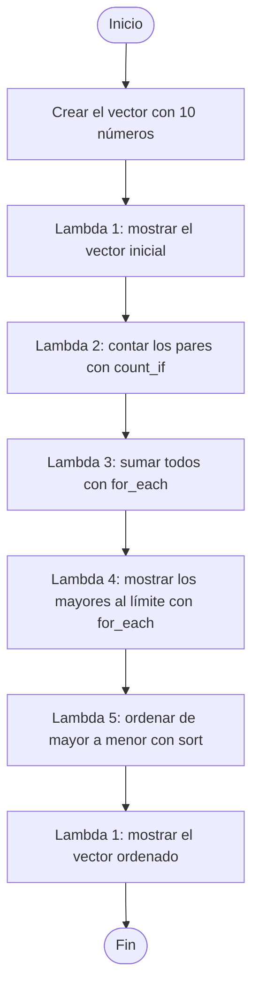
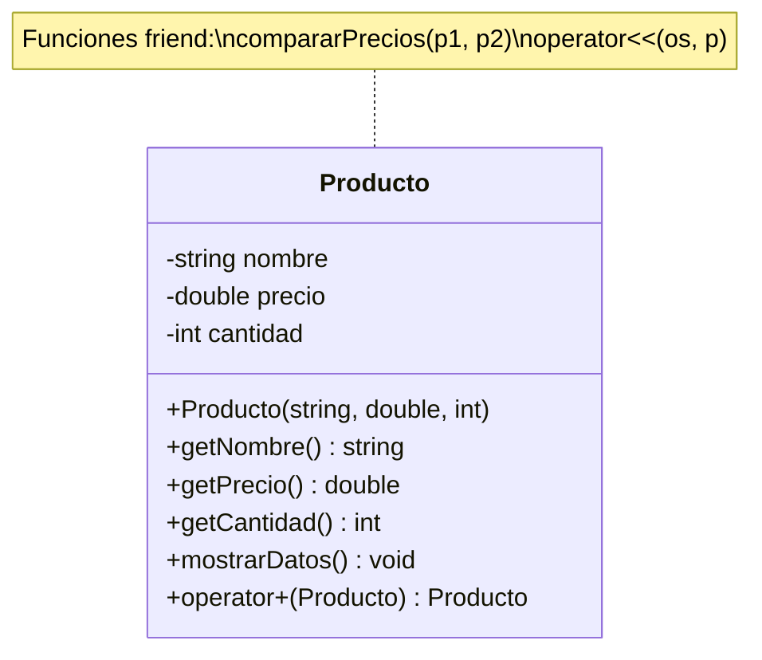

# Tecnología de Objetos


---

## Índice

1. [Información del proyecto](#información-del-proyecto)
2. [Estructura del repositorio](#estructura-del-repositorio)
3. [Práctica de Funciones en C++](#práctica-de-funciones-en-c)
   - [Ejercicio 1: Práctica 4 (Funciones Lambda)](#ejercicio-1-práctica-4-funciones-lambda)
   - [Ejercicio 2: Sistema de Productos (todos los grupos)](#ejercicio-2-sistema-de-productos-todos-los-grupos)
4. [Práctica de Manejo de Errores y Excepciones](#práctica-de-manejo-de-errores-y-excepciones)
5. [Referencias](#referencias)

---


## Estructura del repositorio

```
TO-A/
├── README.md
├── Práctica de Funciones en C++/
│   ├── Prac04_Lambda.cpp
│   ├── sistema_productos.cpp
│   │       
└── Práctica de Manejo de Errores y Excepciones/
    
```

### Requisitos generales

| Requisito | Versión |
|---|---|
| Compilador | `g++` |
| Estándar | C++11 o superior |
| Sistema | Linux / WSL / Windows con MinGW |

---

## Práctica de Funciones en C++

Funciones **inline**, **friend**, **constantes (const)**, **lambda** y **sobrecarga de operadores**. Esta práctica tiene dos ejercicios:

| Ejercicio | Archivo | Conceptos que usa |
|---|---|---|
| Práctica 4: Funciones Lambda | `Prac04_Lambda.cpp` | Lambda (capturas, `count_if`, `for_each`, `sort`) |
| Sistema de Productos (todos los grupos) | `sistema_productos.cpp` | Inline, friend, const, lambda, `operator+` y `operator<<` |

---

### Ejercicio 1: Práctica 4 (Funciones Lambda)

Archivo: `Práctica de Funciones en C++/Prac04_Lambda.cpp`

#### 1. ¿Qué se pedía?

Usar funciones lambda para procesar datos de un vector de forma rápida. El enunciado pedía:

1. Crear un `vector<int>` con al menos 10 números.
2. Usar una lambda para contar los números pares.
3. Usar una lambda para calcular la suma total.
4. Usar una lambda para mostrar los números mayores que un valor dado.
5. Reto adicional: ordenar el vector con `std::sort` y una lambda personalizada.

##### Requisitos del enunciado y cómo se cumplen

| Requisito | ¿Cumplido? | Dónde se cumple |
|---|---|---|
| Vector con al menos 10 números | Sí | `numeros` tiene 10 elementos |
| Contar los números pares | Sí | Lambda 2 (`esPar`) con `std::count_if` |
| Calcular la suma total | Sí | Lambda 3 (`sumar`) con `std::for_each` |
| Mostrar los mayores que un valor dado | Sí | Lambda 4 (`mostrarMayores`), con `limite = 10` |
| Reto: ordenar con `std::sort` y lambda | Sí | Lambda 5 (`comparadorDescendente`) |
| Mostrar el vector (apoyo) | Sí | Lambda 1 (`mostrarVector`) |

#### 2. ¿Qué es una lambda?

Una lambda es una función **sin nombre** que se escribe en el mismo lugar donde se va a usar. Sirve para cosas cortas y rápidas, como filtrar, recorrer o ordenar datos.

Su forma general es:

```
[captura](parámetros) { cuerpo }
```

- **`[captura]`**: las variables de afuera que la lambda puede usar.
  - `[]` no usa nada de afuera.
  - `[limite]` usa una **copia** de la variable (captura por valor).
  - `[&sumaTotal]` usa la **variable original** y puede cambiarla (captura por referencia).
- **`(parámetros)`**: los datos que recibe, igual que una función normal.
- **`{ cuerpo }`**: lo que hace la lambda.

##### Tipos de captura (comparación)

| Tipo | Sintaxis | La lambda usa... | ¿Puede cambiar la variable original? | Ejemplo en esta práctica |
|---|---|---|---|---|
| Sin captura | `[]` | Solo lo que recibe por parámetro | No aplica | `mostrarVector`, `esPar`, `comparadorDescendente` |
| Por valor | `[limite]` | Una **copia** de la variable | No | `mostrarMayores` |
| Por referencia | `[&sumaTotal]` | La variable **original** | Sí | `sumar` |

#### 3. Código completo

```cpp
#include <iostream>
#include <vector>
#include <algorithm>

int main() {
    std::vector<int> numeros = {12, 5, 8, 19, 24, 3, 17, 30, 1, 10};

    // Lambda 1: Imprime los elementos de un vector recibido por referencia constante
    auto mostrarVector = [](const std::vector<int>& vec) {
        for (int n : vec) {
            std::cout << n << " ";
        }
        std::cout << "\n";
    };

    std::cout << "Resultado Lambda 1 - Vector inicial:\n";
    mostrarVector(numeros);

    // Lambda 2: Comprueba si un numero es par retornando un valor booleano
    auto esPar = [](int n) {
        return n % 2 == 0;
    };
    int cantidadPares = std::count_if(numeros.begin(), numeros.end(), esPar);
    std::cout << "\nResultado Lambda 2 - Cantidad de numeros pares:\n" << cantidadPares << "\n";

    // Lambda 3: Captura la variable sumaTotal por referencia y acumula el valor de cada elemento
    int sumaTotal = 0;
    auto sumar = [&sumaTotal](int n) {
        sumaTotal += n;
    };
    std::for_each(numeros.begin(), numeros.end(), sumar);
    std::cout << "\nResultado Lambda 3 - Suma total de elementos:\n" << sumaTotal << "\n";

    // Lambda 4: Captura por valor la variable limite e imprime los elementos que la superan
    int limite = 10;
    std::cout << "\nResultado Lambda 4 - Elementos mayores al limite indicado:\n";
    auto mostrarMayores = [limite](int n) {
        if (n > limite) {
            std::cout << n << " ";
        }
    };
    std::for_each(numeros.begin(), numeros.end(), mostrarMayores);
    std::cout << "\n";

    // Lambda 5: Compara dos elementos y retorna verdadero si el primero es mayor para ordenar de forma descendente
    auto comparadorDescendente = [](int a, int b) {
        return a > b;
    };
    std::sort(numeros.begin(), numeros.end(), comparadorDescendente);

    std::cout << "\nResultado Lambda 5 - Vector ordenado de mayor a menor:\n";
    mostrarVector(numeros);

    return 0;
}
```

#### 4. Explicación paso a paso

##### Diagrama de flujo del programa



##### Librerías usadas

| Librería | Para qué se usa |
|---|---|
| `<iostream>` | Mostrar datos en pantalla con `std::cout`. |
| `<vector>` | Poder usar `std::vector`, una lista de datos que puede cambiar de tamaño. |
| `<algorithm>` | Usar `std::count_if`, `std::for_each` y `std::sort`, que reciben lambdas. |

Funciones de `<algorithm>` que reciben lambdas en este programa:

| Función | Qué hace | Lambda que recibe |
|---|---|---|
| `std::count_if` | Cuenta cuántos elementos cumplen una condición | `esPar` |
| `std::for_each` | Aplica una acción a cada elemento del vector | `sumar` y `mostrarMayores` |
| `std::sort` | Ordena el vector según el criterio que se le da | `comparadorDescendente` |

##### El vector

```cpp
std::vector<int> numeros = {12, 5, 8, 19, 24, 3, 17, 30, 1, 10};
```

Se crea un vector con **10 números enteros**, que es el mínimo que pedía el enunciado. Todas las lambdas trabajan con estos datos.

##### Lambda 1: `mostrarVector` (mostrar el vector)

```cpp
auto mostrarVector = [](const std::vector<int>& vec) {
    for (int n : vec) {
        std::cout << n << " ";
    }
    std::cout << "\n";
};
```

- **Qué hace:** recorre el vector y muestra cada número separado por un espacio.
- **Captura `[]`:** vacía, porque no necesita variables de afuera. Todo lo que usa lo recibe por parámetro.
- **Parámetro `const std::vector<int>& vec`:** recibe el vector **por referencia** (`&`), así no se hace una copia, y es **constante** (`const`), así la lambda no puede modificarlo.
- **Por qué se usa dos veces:** se escribe una sola vez y se reutiliza para mostrar el vector al inicio y al final (ya ordenado).

##### Lambda 2: `esPar` (contar los pares)

```cpp
auto esPar = [](int n) {
    return n % 2 == 0;
};
int cantidadPares = std::count_if(numeros.begin(), numeros.end(), esPar);
```

- **Qué hace:** revisa si un número es par. Un número es par si al dividirlo entre 2 el residuo (`%`) es 0.
- **Retorna:** `true` si es par, `false` si no lo es.
- **`std::count_if`:** recorre todo el vector y **cuenta** cuántas veces la lambda devolvió `true`.
- **Pares encontrados:** 12, 8, 24, 30 y 10, por lo tanto el resultado es **5**.

Seguimiento de la lambda, número por número:

| Número | `n % 2` | ¿Es par? |
|---|---|---|
| 12 | 0 | Sí |
| 5 | 1 | No |
| 8 | 0 | Sí |
| 19 | 1 | No |
| 24 | 0 | Sí |
| 3 | 1 | No |
| 17 | 1 | No |
| 30 | 0 | Sí |
| 1 | 1 | No |
| 10 | 0 | Sí |
| **Total de pares** | | **5** |

##### Lambda 3: `sumar` (suma total)

```cpp
int sumaTotal = 0;
auto sumar = [&sumaTotal](int n) {
    sumaTotal += n;
};
std::for_each(numeros.begin(), numeros.end(), sumar);
```

- **Qué hace:** va sumando cada número del vector en la variable `sumaTotal`.
- **Captura `[&sumaTotal]`:** el `&` significa captura **por referencia**. La lambda trabaja con la variable original, no con una copia, por eso puede ir acumulando la suma y el valor final se ve afuera.
- **`std::for_each`:** recorre todo el vector y le pasa cada número a la lambda.
- **Resultado:** 12 + 5 + 8 + 19 + 24 + 3 + 17 + 30 + 1 + 10 = **129**.

Cómo va cambiando `sumaTotal` en cada paso:

| Paso | Número `n` | `sumaTotal` antes | `sumaTotal` después |
|---|---|---|---|
| 1 | 12 | 0 | 12 |
| 2 | 5 | 12 | 17 |
| 3 | 8 | 17 | 25 |
| 4 | 19 | 25 | 44 |
| 5 | 24 | 44 | 68 |
| 6 | 3 | 68 | 71 |
| 7 | 17 | 71 | 88 |
| 8 | 30 | 88 | 118 |
| 9 | 1 | 118 | 119 |
| 10 | 10 | 119 | **129** |

##### Lambda 4: `mostrarMayores` (mayores que un valor)

```cpp
int limite = 10;
auto mostrarMayores = [limite](int n) {
    if (n > limite) {
        std::cout << n << " ";
    }
};
std::for_each(numeros.begin(), numeros.end(), mostrarMayores);
```

- **Qué hace:** muestra solo los números que son mayores que `limite`.
- **Captura `[limite]`:** sin `&`, es captura **por valor**. La lambda guarda una **copia** de `limite` (que vale 10). Solo necesita leer ese valor, no cambiarlo.
- **Resultado:** los mayores que 10 son **12, 19, 24, 17 y 30**. El 10 no aparece porque no es mayor, es igual.

Seguimiento con `limite = 10`:

| Número `n` | ¿`n > 10`? | ¿Se muestra? |
|---|---|---|
| 12 | Sí | Sí |
| 5 | No | No |
| 8 | No | No |
| 19 | Sí | Sí |
| 24 | Sí | Sí |
| 3 | No | No |
| 17 | Sí | Sí |
| 30 | Sí | Sí |
| 1 | No | No |
| 10 | No (es igual, no mayor) | No |

##### Lambda 5: `comparadorDescendente` (ordenar, reto adicional)

```cpp
auto comparadorDescendente = [](int a, int b) {
    return a > b;
};
std::sort(numeros.begin(), numeros.end(), comparadorDescendente);
```

- **Qué hace:** le dice a `std::sort` cómo comparar dos números. Devuelve `true` si `a` es mayor que `b`, así el mayor va primero.
- **Por qué es necesaria:** por defecto `std::sort` ordena de menor a mayor. Con esta lambda personalizada se ordena de **mayor a menor**.
- **Resultado:** `30 24 19 17 12 10 8 5 3 1`.

Vector antes y después de ordenar:

| Posición | Antes | Después |
|---|---|---|
| 1 | 12 | 30 |
| 2 | 5 | 24 |
| 3 | 8 | 19 |
| 4 | 19 | 17 |
| 5 | 24 | 12 |
| 6 | 3 | 10 |
| 7 | 17 | 8 |
| 8 | 30 | 5 |
| 9 | 1 | 3 |
| 10 | 10 | 1 |

#### 5. Salida del programa

```
Resultado Lambda 1 - Vector inicial:
12 5 8 19 24 3 17 30 1 10 

Resultado Lambda 2 - Cantidad de numeros pares:
5

Resultado Lambda 3 - Suma total de elementos:
129

Resultado Lambda 4 - Elementos mayores al limite indicado:
12 19 24 17 30 

Resultado Lambda 5 - Vector ordenado de mayor a menor:
30 24 19 17 12 10 8 5 3 1 
```

#### 6. Resumen de las lambdas

| Lambda | Captura | Qué hace | Se usa con | Resultado |
|---|---|---|---|---|
| `mostrarVector` | `[]` | Imprime el vector | Llamada directa | Muestra los 10 números |
| `esPar` | `[]` | Dice si un número es par | `std::count_if` | 5 pares |
| `sumar` | `[&sumaTotal]` (referencia) | Acumula la suma | `std::for_each` | 129 |
| `mostrarMayores` | `[limite]` (valor) | Muestra los mayores al límite | `std::for_each` | 12 19 24 17 30 |
| `comparadorDescendente` | `[]` | Compara para ordenar de mayor a menor | `std::sort` | 30 24 19 17 12 10 8 5 3 1 |

#### 7. Cómo compilar y ejecutar

```
g++ Prac04_Lambda.cpp -o Prac04_Lambda
./Prac04_Lambda
```

#### 8. Conclusión

Las lambdas permiten escribir funciones cortas justo donde se necesitan, sin tener que declarar una función aparte. En esta práctica se vio cómo usarlas para mostrar, contar, sumar, filtrar y ordenar datos de un vector, y cómo la **captura** (por valor o por referencia) controla qué variables de afuera puede usar cada lambda.

---

### Ejercicio 2: Sistema de Productos (todos los grupos)

Archivo: `Práctica de Funciones en C++/sistema_productos.cpp`

#### 1. ¿Qué se pedía?

Diseñar un programa llamado **"Sistema de Productos"** que integre todas las funciones del tema en un mini sistema. El enunciado pedía:

1. Usar una función **inline** para calcular el descuento de un producto.
2. Tener una clase `Producto` con atributos privados y una función **friend** que compare precios.
3. Usar funciones **const** para mostrar datos sin modificarlos.
4. Aplicar una **lambda** para filtrar productos por precio.
5. Sobrecargar el operador **+** para combinar productos (sumar precios o cantidades).
6. Reto adicional: sobrecargar el operador **<<** para mostrar el producto en formato legible.

##### Requisitos del enunciado y cómo se cumplen

| Requisito | ¿Cumplido? | Dónde se cumple |
|---|---|---|
| Función inline para el descuento | Sí | `calcularDescuento(precio, porcentaje)` |
| Clase `Producto` con atributos privados | Sí | `nombre`, `precio` y `cantidad` son `private` |
| Función friend que compare precios | Sí | `compararPrecios(p1, p2)` |
| Funciones const para mostrar datos | Sí | `getNombre()`, `getPrecio()`, `getCantidad()` y `mostrarDatos()` |
| Lambda para filtrar por precio | Sí | `filtrarPorPrecio` con `limitePrecio = 100` |
| Sobrecarga del operador + | Sí | `Producto operator+(const Producto&) const` |
| Reto: sobrecarga del operador << | Sí | `friend std::ostream& operator<<(...)` |

#### 2. Conceptos aplicados

| Concepto | Palabra clave | Dónde se usa en el programa | Propósito |
|---|---|---|---|
| Función inline | `inline` | `calcularDescuento` | Calcular el descuento sin el costo de una llamada |
| Función friend | `friend` | `compararPrecios` | Leer atributos privados para comparar precios |
| Funciones constantes | `const` | `getNombre()`, `getPrecio()`, `getCantidad()`, `mostrarDatos()` | Consultar datos sin modificar el objeto |
| Función lambda | `[ ]( ) { }` | `filtrarPorPrecio` | Filtrar productos con precio menor a un límite |
| Sobrecarga de `+` | `operator+` | `inventario[1] + inventario[2]` | Combinar dos productos (suma precios y cantidades) |
| Sobrecarga de `<<` | `operator<<` | `std::cout << producto` | Mostrar el producto en formato de tabla |

#### 3. Diseño del programa

##### Diagrama de clase



##### Diagrama de flujo del programa


##### Inventario de prueba

| Producto | Precio ($) | Cantidad |
|---|---:|---:|
| Laptop | 1200.00 | 5 |
| Mouse | 25.00 | 20 |
| Teclado | 45.00 | 15 |
| Monitor | 300.00 | 8 |
| Audifonos | 80.00 | 12 |

#### 4. Código completo

```cpp
#include <iostream>
#include <string>
#include <vector>
#include <algorithm>
#include <iomanip> // Libreria para alineacion simetrica de columnas

// 1. FUNCION INLINE: Calcula el precio aplicando un porcentaje de descuento
inline double calcularDescuento(double precio, double porcentaje) {
    return precio * (1.0 - porcentaje / 100.0);
}

class Producto {
private:
    std::string nombre;
    double precio;
    int cantidad;

public:
    // Constructor de la clase
    Producto(std::string n = "Sin nombre", double p = 0.0, int c = 0)
        : nombre(n), precio(p), cantidad(c) {}

    // 3. FUNCIONES CONSTANTES: Permiten consultar atributos sin modificar el objeto
    std::string getNombre() const {
        return nombre;
    }

    double getPrecio() const {
        return precio;
    }

    int getCantidad() const {
        return cantidad;
    }

    void mostrarDatos() const {
        std::cout << std::left << std::setw(18) << nombre
                  << " | $" << std::right << std::setw(8) << std::fixed << std::setprecision(2) << precio
                  << " | " << std::right << std::setw(8) << cantidad << "\n";
    }

    // 5. SOBRECARGA DEL OPERADOR +: Combina dos productos sumando precios y cantidades
    Producto operator+(const Producto& otro) const {
        std::string nombreCombinado = nombre + " + " + otro.nombre;
        double precioSumado = precio + otro.precio;
        int cantidadTotal = cantidad + otro.cantidad;
        return Producto(nombreCombinado, precioSumado, cantidadTotal);
    }

    // 2. FUNCION FRIEND: Accede a atributos privados para comparar precios
    friend void compararPrecios(const Producto& p1, const Producto& p2);

    // RETO ADICIONAL: Sobrecarga del operador << para imprimir en formato de tabla alineada
    friend std::ostream& operator<<(std::ostream& os, const Producto& p) {
        os << std::left << std::setw(18) << p.nombre
           << " | $" << std::right << std::setw(8) << std::fixed << std::setprecision(2) << p.precio
           << " | " << std::right << std::setw(8) << p.cantidad;
        return os;
    }
};

// Implementacion de la funcion amiga
void compararPrecios(const Producto& p1, const Producto& p2) {
    std::cout << std::left << std::setw(12) << p1.nombre << " vs " << std::setw(12) << p2.nombre << " -> ";
    if (p1.precio > p2.precio) {
        std::cout << p1.nombre << " es mas caro\n";
    } else if (p2.precio > p1.precio) {
        std::cout << p2.nombre << " es mas caro\n";
    } else {
        std::cout << "Ambos tienen el mismo precio\n";
    }
}

// Funcion auxiliar para imprimir el encabezado de las tablas
void imprimirEncabezadoTabla() {
    std::cout << std::left << std::setw(18) << "PRODUCTO"
              << " | " << std::right << std::setw(9) << "PRECIO"
              << " | " << std::right << std::setw(8) << "CANTIDAD" << "\n";
    std::cout << std::string(42, '-') << "\n";
}

int main() {
    std::vector<Producto> inventario = {
        Producto("Laptop", 1200.0, 5),
        Producto("Mouse", 25.0, 20),
        Producto("Teclado", 45.0, 15),
        Producto("Monitor", 300.0, 8),
        Producto("Audifonos", 80.0, 12)
    };

    std::cout << "==========================================" << "\n";
    std::cout << "          SISTEMA DE PRODUCTOS            " << "\n";
    std::cout << "==========================================" << "\n\n";

    // Demostracion del RETO ADICIONAL y FUNCION CONST: Impresion simetrica con operador <<
    std::cout << "--- LISTA DE PRODUCTOS EN INVENTARIO ---\n";
    imprimirEncabezadoTabla();
    for (const auto& prod : inventario) {
        std::cout << prod << "\n";
    }
    std::cout << std::string(42, '-') << "\n\n";

    // Demostracion de FUNCION INLINE
    std::cout << "--- CALCULO DE DESCUENTO (Funcion Inline) ---\n";
    double precioOriginal = inventario[0].getPrecio();
    double porcentajeDescuento = 15.0;
    double precioFinal = calcularDescuento(precioOriginal, porcentajeDescuento);

    std::cout << std::left << std::setw(22) << "Producto:" << inventario[0].getNombre() << "\n";
    std::cout << std::left << std::setw(22) << "Precio Original:" << "$" << std::fixed << std::setprecision(2) << precioOriginal << "\n";
    std::cout << std::left << std::setw(22) << "Descuento:" << porcentajeDescuento << "%\n";
    std::cout << std::left << std::setw(22) << "Precio Con Descuento:" << "$" << precioFinal << "\n\n";

    // Demostracion de FUNCION FRIEND
    std::cout << "--- COMPARACION DE PRECIOS (Funcion Friend) ---\n";
    compararPrecios(inventario[0], inventario[3]);
    compararPrecios(inventario[1], inventario[4]);
    std::cout << "\n";

    // Demostracion de LAMBDA: Filtrar productos por precio menor a un limite
    double limitePrecio = 100.0;
    std::cout << "--- FILTRADO CON LAMBDA (Productos menores a $" << limitePrecio << ") ---\n";
    imprimirEncabezadoTabla();
    auto filtrarPorPrecio = [limitePrecio](const Producto& p) {
        if (p.getPrecio() < limitePrecio) {
            std::cout << p << "\n";
        }
    };
    std::for_each(inventario.begin(), inventario.end(), filtrarPorPrecio);
    std::cout << std::string(42, '-') << "\n\n";

    // Demostracion de SOBRECARGA DEL OPERADOR +
    std::cout << "--- COMBINACION DE PRODUCTOS (Operador +) ---\n";
    Producto combo = inventario[1] + inventario[2]; // Combinar Mouse + Teclado
    imprimirEncabezadoTabla();
    std::cout << combo << "\n";
    std::cout << std::string(42, '-') << "\n";

    return 0;
}
```

#### 5. Explicación paso a paso

##### Librerías usadas

| Librería | Para qué se usa |
|---|---|
| `<iostream>` | Mostrar datos en pantalla con `std::cout`. |
| `<string>` | Manejar el nombre del producto con `std::string`. |
| `<vector>` | Guardar el inventario en un `std::vector<Producto>`. |
| `<algorithm>` | Usar `std::for_each`, que recibe la lambda de filtrado. |
| `<iomanip>` | Alinear columnas y fijar decimales (`setw`, `left`, `right`, `fixed`, `setprecision`). |

##### Función inline: `calcularDescuento`

```cpp
inline double calcularDescuento(double precio, double porcentaje) {
    return precio * (1.0 - porcentaje / 100.0);
}
```

- **Qué hace:** devuelve el precio final después de restar el porcentaje de descuento.
- **Por qué `inline`:** es un cálculo muy corto, así que el compilador puede reemplazar la llamada por el cuerpo de la función y evitar el salto de llamada.
- **En el programa:** se aplica un 15 % a la Laptop, de $1200.00 a **$1020.00**.

| Dato | Valor |
|---|---|
| Precio original | 1200.00 |
| Descuento | 15 % |
| Fórmula | 1200 × (1 − 15/100) = 1200 × 0.85 |
| Precio final | **1020.00** |

##### Clase `Producto` (atributos privados)

- Tiene tres atributos **privados**: `nombre` (`std::string`), `precio` (`double`) y `cantidad` (`int`).
- Desde `main` no se puede escribir `producto.precio`: solo se llega a los datos con los métodos de la clase o con funciones amigas.
- El constructor tiene valores por defecto, así que también se puede crear un producto vacío (`"Sin nombre"`, 0.0, 0).

##### Función friend: `compararPrecios`

```cpp
friend void compararPrecios(const Producto& p1, const Producto& p2);
```

- **Qué hace:** compara los precios de dos productos e imprime cuál es más caro.
- **Por qué es friend:** se declara dentro de la clase con `friend`, pero se implementa fuera como función normal. Así puede leer `p1.precio` y `p2.precio` directamente, sin usar los getters.
- **Parámetros:** `const Producto&`, para no copiar los objetos ni modificarlos.

| Comparación | Precios | Resultado |
|---|---|---|
| Laptop vs Monitor | 1200.00 vs 300.00 | Laptop es más caro |
| Mouse vs Audifonos | 25.00 vs 80.00 | Audifonos es más caro |

##### Funciones constantes (`const`)

| Método | Qué hace | ¿Modifica el objeto? |
|---|---|---|
| `getNombre() const` | Devuelve el nombre | No |
| `getPrecio() const` | Devuelve el precio | No |
| `getCantidad() const` | Devuelve la cantidad | No |
| `mostrarDatos() const` | Imprime una fila con los datos del producto | No |

- El `const` al final garantiza que la función no cambia los atributos. Si se intentara, el compilador mostraría un error.
- Gracias a eso se pueden usar con objetos constantes, como el parámetro `const Producto& p` de la lambda o el recorrido `for (const auto& prod : inventario)`.
- **Nota:** `mostrarDatos()` queda definida en la clase, pero la impresión de las tablas se hace con el operador `<<`, por lo que no se llama en `main`.

##### Función lambda: `filtrarPorPrecio`

```cpp
double limitePrecio = 100.0;
auto filtrarPorPrecio = [limitePrecio](const Producto& p) {
    if (p.getPrecio() < limitePrecio) {
        std::cout << p << "\n";
    }
};
std::for_each(inventario.begin(), inventario.end(), filtrarPorPrecio);
```

- **Qué hace:** muestra solo los productos con precio menor al límite.
- **Captura `[limitePrecio]`:** por **valor**. La lambda guarda una copia del límite (100.0) y solo lo lee.
- **Se usa con:** `std::for_each`, que le pasa cada producto del inventario.

| Producto | Precio | ¿Precio < 100? | ¿Se muestra? |
|---|---:|---|---|
| Laptop | 1200.00 | No | No |
| Mouse | 25.00 | Sí | Sí |
| Teclado | 45.00 | Sí | Sí |
| Monitor | 300.00 | No | No |
| Audifonos | 80.00 | Sí | Sí |

##### Sobrecarga del operador `+`

```cpp
Producto operator+(const Producto& otro) const {
    std::string nombreCombinado = nombre + " + " + otro.nombre;
    double precioSumado = precio + otro.precio;
    int cantidadTotal = cantidad + otro.cantidad;
    return Producto(nombreCombinado, precioSumado, cantidadTotal);
}
```

- **Qué hace:** crea un producto nuevo que une los nombres, suma los precios y suma las cantidades.
- **Es `const`:** no modifica ninguno de los dos productos originales.

| Atributo | Mouse | Teclado | Resultado (Mouse + Teclado) |
|---|---|---|---|
| Nombre | Mouse | Teclado | Mouse + Teclado |
| Precio | 25.00 | 45.00 | **70.00** |
| Cantidad | 20 | 15 | **35** |

##### Sobrecarga del operador `<<` (reto adicional)

```cpp
friend std::ostream& operator<<(std::ostream& os, const Producto& p) {
    os << std::left << std::setw(18) << p.nombre
       << " | $" << std::right << std::setw(8) << std::fixed << std::setprecision(2) << p.precio
       << " | " << std::right << std::setw(8) << p.cantidad;
    return os;
}
```

- **Qué hace:** permite escribir `std::cout << producto` y que salga una fila de tabla con formato.
- **Por qué es friend:** necesita leer los atributos privados del producto.
- **Por qué retorna `os`:** así se pueden encadenar salidas, por ejemplo `std::cout << prod << "\n"`.
- **Manipuladores de `<iomanip>`:**

| Manipulador | Para qué sirve |
|---|---|
| `setw(n)` | Fija el ancho del campo en `n` caracteres |
| `left` / `right` | Alinea a la izquierda o a la derecha |
| `fixed` | Muestra los decimales de forma fija |
| `setprecision(2)` | Muestra 2 decimales |

#### 6. Salida del programa


```
==========================================
          SISTEMA DE PRODUCTOS
==========================================

--- LISTA DE PRODUCTOS EN INVENTARIO ---
PRODUCTO           |    PRECIO | CANTIDAD
------------------------------------------
Laptop             | $ 1200.00 |        5
Mouse              | $   25.00 |       20
Teclado            | $   45.00 |       15
Monitor            | $  300.00 |        8
Audifonos          | $   80.00 |       12
------------------------------------------

--- CALCULO DE DESCUENTO (Funcion Inline) ---
Producto:             Laptop
Precio Original:      $1200.00
Descuento:            15.00%
Precio Con Descuento: $1020.00

--- COMPARACION DE PRECIOS (Funcion Friend) ---
Laptop       vs Monitor      -> Laptop es mas caro
Mouse        vs Audifonos    -> Audifonos es mas caro

--- FILTRADO CON LAMBDA (Productos menores a $100.00) ---
PRODUCTO           |    PRECIO | CANTIDAD
------------------------------------------
Mouse              | $   25.00 |       20
Teclado            | $   45.00 |       15
Audifonos          | $   80.00 |       12
------------------------------------------

--- COMBINACION DE PRODUCTOS (Operador +) ---
PRODUCTO           |    PRECIO | CANTIDAD
------------------------------------------
Mouse + Teclado    | $   70.00 |       35
------------------------------------------
```

#### 7. Resultados

| Operación | Entrada | Resultado |
|---|---|---|
| Descuento (inline) | Laptop $1200.00 con 15 % | **$1020.00** |
| Comparación (friend) | Laptop vs Monitor | Laptop es más caro |
| Comparación (friend) | Mouse vs Audifonos | Audifonos es más caro |
| Filtro (lambda) | Precio menor a $100 | Mouse, Teclado y Audifonos |
| Combinación (`operator+`) | Mouse + Teclado | **$70.00**, 35 unidades |

#### 8. Cómo compilar y ejecutar

```
g++ -std=c++11 sistema_productos.cpp -o sistema_productos
./sistema_productos
```

#### 9. Reto adicional

✅ **Sobrecarga del operador `<<`:** el producto se imprime directamente con `std::cout << producto`, en formato de tabla alineada. Se usa en la lista del inventario, en el filtrado con lambda y en el producto combinado.

#### 10. Conclusión

El Sistema de Productos integra en un solo programa todos los conceptos de la práctica. La función **inline** resuelve el descuento sin costo de llamada, la función **friend** compara precios accediendo a datos privados, las funciones **const** protegen el estado del objeto, la **lambda** filtra el inventario capturando el límite de precio, y la **sobrecarga de operadores** (`+` y `<<`) permite combinar y mostrar productos de forma natural.

---

## Práctica de Manejo de Errores y Excepciones


<!--
Completar con la misma estructura de la práctica anterior:
#### 1. ¿Qué se pedía?
#### 2. Fundamento teórico
#### 3. Código completo
#### 4. Explicación paso a paso
#### 5. Salida del programa
#### 6. Cómo compilar y ejecutar
#### 7. Conclusión
-->

---

## Referencias

- Deitel, P., & Deitel, H. (2017). *C++ how to program* (10.ª ed.). Pearson.
- Lippman, S. B., Lajoie, J., & Moo, B. E. (2013). *C++ primer* (5.ª ed.). Addison-Wesley.
- Meyers, S. (2014). *Effective modern C++: 42 specific ways to improve your use of C++11 and C++14*. O'Reilly Media.
- Stroustrup, B. (2013). *The C++ programming language* (4.ª ed.). Addison-Wesley.
- cppreference.com. (s. f.). *Lambda expressions*. https://en.cppreference.com/w/cpp/language/lambda